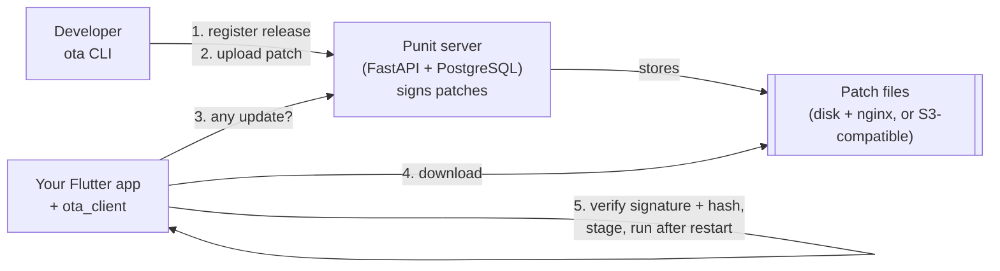

# Punit

**Self-hosted, experimental over-the-air (OTA) patch delivery for Flutter apps.**

> [!WARNING]
> **Punit is an experimental, self-hosted open-source project (v0.1.0-alpha).** It has undergone
> internal testing but has **not** yet been comprehensively validated in production.
>
> - It has **not** undergone an independent security audit.
> - No load tests have been run; Punit makes **no scale or capacity claim**.
> - Punit distributes code and configuration that your app will run. A mistake in how you operate
>   it, or a bug in Punit, can break apps in the field or let an attacker ship code to your users.
> - **Do not use Punit for production OTA delivery** until you have independently validated its
>   security, reliability, compatibility, rollback, signing and recovery for your own apps.
> - You run Punit **at your own risk**. See [LICENSE](LICENSE) (Apache-2.0, sections 7 and 8: no
>   warranty, no liability).

## What problem it solves

A Flutter bug fix normally needs a new store build, a store review and users who update. Punit lets
you send certain fixes **directly to installed apps**:

- **Android Dart code patches** (experimental): change Dart code, run one command, and phones run
  the new code after their next restart. Built on stock Flutter, without an engine fork.
- **Config patches** (`mock-v1`): signed files that your app reads at start.

Punit is **self-hosted only**. There is no hosted Punit service: you run the server, keep the
signing key and decide what gets shipped.

## Key features

- **Release-bound patches:** every patch belongs to exactly one store build (`1.0.0+1`); patches
  never cross versions.
- **Signed and verified:** ES256 signatures over all patch metadata plus SHA-256, verified on the
  device with keys compiled into the app, **before** anything runs.
- **Channels and staged rollouts:** `dev`, `staging`, `production` (and your own), deterministic
  percentage rollouts.
- **Rollback and revoke** from the server, plus **automatic on-device fallback** when a new patch
  fails to start.
- **Build guards:** the CLI refuses Android patches that change anything other than Dart code, or
  that use a different Flutter version.
- **Simple to run:** FastAPI + PostgreSQL + a static file server, in Docker Compose; a small admin
  web page and a CLI.

## How it works



1. You register a **store release** of your app (e.g. `android 1.0.0+1`).
2. You upload a **patch** for that exact release. The server stores the file under its SHA-256 and
   **signs** a canonical message describing it (app, release, patch number, platform, arch,
   format, hashes, size).
3. You **publish** it to a channel at a percentage. Devices are bucketed deterministically, so
   raising 1% → 10% keeps the first 1%.
4. `ota_client` **checks**, verifies the **signature**, **downloads** the file from your file
   server or bucket, checks **size and SHA-256**, stages it and activates it on the next start.
5. If a patched app fails to start, the client **falls back** to the last good code by itself. You
   can also **roll back** or **revoke** a patch from the server.

Details: [docs/architecture.md](docs/architecture.md) · terms: [docs/concepts.md](docs/concepts.md).

## Technology stack

| Part | Technology |
|---|---|
| Server | Python 3.13, FastAPI, Uvicorn, SQLAlchemy 2, Alembic, PyJWT, `cryptography`, boto3 |
| Database | PostgreSQL 17 (SQLite only for tests) |
| File serving | nginx 1.27 (local disk) or any S3-compatible bucket; Caddy 2.8 for HTTPS in the single-server setup |
| Client | Dart / Flutter package `ota_client` (`crypto`, `pointycastle`, `http`, `path_provider`) + an Android part in Java 17 |
| Tooling | Python CLI `ota` (`httpx`, `bsdiff4`), Bash scripts, Docker Compose, GitHub Actions |

## Project status

| Area | State in v0.1.0-alpha |
|---|---|
| Control plane (FastAPI + PostgreSQL) | Working, internally tested, automated tests |
| Signed patch metadata (ES256) + SHA-256 | Working, covered by tests and `scripts/verify_demo.sh` |
| Channels, percentage rollout, rollback, revoke | Working, internally tested |
| `mock-v1` config patches | Working; used by the local demo |
| Android Dart code patches (`aot-bidiff-android-v1`, stock Flutter) | **Experimental.** Internally tested on a small number of devices |
| iOS code patches | **Not supported** |
| Local Docker stack | Working; tested by the maintainers on Linux |
| Single-server Docker deployment (`deploy/`) | **Draft, not yet verified end to end** |
| Storage | Local disk + nginx, or S3-compatible buckets. **No Azure Blob** |
| Signing key | Local PEM file or env var. **No Key Vault / KMS / HSM** |
| Users, roles (RBAC), audit log | **Not implemented**: one shared admin API key |
| Redis / caching | **Not used** |
| Scale | **No load tests.** 1M active installs is a roadmap design goal only, not a tested capacity |

Full breakdown: [docs/limitations.md](docs/limitations.md) · roadmap:
[docs/roadmap/](docs/roadmap/README.md).

## Supported platforms (verified)

Only what was actually exercised for this release:

- **Server:** Linux (Ubuntu) with Docker Engine + Compose v2. macOS/Windows Docker Desktop hosts
  are **not tested**.
- **Flutter:** `ota_client` analysis and unit tests with Flutter 3.44 stable. Requires
  Flutter ≥ 3.27 and Dart ≥ 3.12.
- **Devices:** Android emulators and devices, internal testing only. No device compatibility
  matrix is published. **iOS is not tested.**

## Installation overview

Docker is the official installation method. Today you can run the full stack **locally**; a
tested server quickstart is still to come.

1. [Run the local stack](docs/installation.md) (Docker Compose: PostgreSQL, API, nginx).
2. [Connect your Flutter app](docs/flutter-integration.md).
3. [Ship a release and patches](docs/releases-and-patches.md), then [roll them out](docs/rollouts.md).
4. For a server: [docs/operations.md](docs/operations.md) (draft, not yet verified).

## Quickstart (local, about 10 minutes)

Requires Git, Docker with Compose v2, and free ports 8000, 8080 and 5432.

```bash
git clone https://github.com/punitsoni22/flutter_ota_system.git
cd flutter_ota_system
cp .env.example .env                 # fake, local-only values
./scripts/setup_local.sh             # builds, creates a LOCAL dev signing key, starts the stack
./scripts/seed_demo.sh               # app punit-demo, channel dev, release android 1.0.0+1
./scripts/publish_test_patch.sh      # signed mock-v1 test patch, 100% of dev
./scripts/verify_demo.sh             # end-to-end checks; exits non-zero on any failure
```

Expected last line:

```
RESULT: all checks passed (artifact pipeline; mock-v1 does not execute code)
```

Then open the admin page at <http://localhost:8000/admin> (key: `OTA_ADMIN_API_KEY` from `.env`)
and the API docs at <http://localhost:8000/docs>. To see the patch in the example app and try
rollback, crash protection and rollouts, continue with [docs/installation.md](docs/installation.md).

Clean up with `./scripts/cleanup_local.sh` (deletes the local database, files and dev key).

## Example usage

In your app (Android code patches; full guide in
[docs/flutter-integration.md](docs/flutter-integration.md)):

```dart
final client = OtaClient(OtaConfig(
  serverUrl: 'https://ota.example.com',
  appSlug: 'my-app',
  releaseVersion: '${info.version}+${info.buildNumber}',   // from package_info_plus
  publicKeys: {'prod-1': '<uncompressed_point_base64 from `ota key show`>'},
  runtime: AotPatchRuntime(),
));
await client.boot();                                        // never throws
client.markBootSuccessfulAfterFirstFrame(stableFor: const Duration(seconds: 5));
await client.checkForUpdate();                              // never throws; returns an UpdateResult
```

On your machine:

```bash
ota app create my-app "My App"
ota release android my-app -- --dart-define=OTA_SERVER_URL=https://ota.example.com …   # store build
# change Dart code, then:
ota patch android my-app --channel staging --note "fix checkout total"
ota patch promote <patch_id> --percent 1                                              # canary
ota patch rollout <patch_id> --channel production --percent 100
ota patch rollback <patch_id>                                                         # undo
```

## Screenshots

No screenshots are published yet. The admin page is a single static page at `/admin`; run the
[quickstart](#quickstart-local-about-10-minutes) to see it.

## Documentation

Everything is indexed in [docs/index.md](docs/index.md):

| | |
|---|---|
| Tutorial | [Installation](docs/installation.md) |
| How-to | [Flutter integration](docs/flutter-integration.md) · [Releases and patches](docs/releases-and-patches.md) · [Rollouts](docs/rollouts.md) · [Operations](docs/operations.md) · [Troubleshooting](docs/troubleshooting.md) |
| Reference | [API](docs/api-reference.md) · [CLI](docs/cli-reference.md) · [Configuration](docs/configuration.md) |
| Explanation | [Concepts](docs/concepts.md) · [Architecture](docs/architecture.md) · [Security](docs/security.md) · [Limitations](docs/limitations.md) · [Roadmap](docs/roadmap/README.md) |

## Known limitations

- Alpha: the API, database schema and patch formats may change without migration paths.
- Android code patches only change Dart code, need the exact registered store build and the same
  Flutter version, and depend on Flutter internals. No iOS code patches.
- One shared admin API key; no users, roles, SSO or audit log.
- Open device registration; no rate limiting. Patch files are public by hash: never put secrets
  in patches.
- Signing key in a file or env var; no Key Vault/KMS/HSM; no key-rotation tooling.
- Devices learn about patches, rollbacks and revocations only when the app checks.
- No dashboards, alerts or automatic rollout pausing; no load tests.
- The Android application ID and Java package use `dev.flutterota.*`. Ownership of the domain
  `flutterota.dev` has **not** been confirmed, so these identifiers may change before a stable
  release. Use your own application ID in your apps.

More: [docs/limitations.md](docs/limitations.md). Known bugs: [docs/known-issues.md](docs/known-issues.md).

## Security

Read [docs/security.md](docs/security.md) before deploying anything. Report vulnerabilities
privately as described in [SECURITY.md](SECURITY.md), **never in public issues**.

## Contributing

Contributions are welcome: bug reports, tests, documentation and careful fixes. Read
[CONTRIBUTING.md](CONTRIBUTING.md) and the [Code of Conduct](CODE_OF_CONDUCT.md).

## Licence

Apache License 2.0. See [LICENSE](LICENSE), [NOTICE](NOTICE) and
[THIRD_PARTY_NOTICES.md](THIRD_PARTY_NOTICES.md).

Punit is not affiliated with or endorsed by Google, the Flutter project or Shorebird.
"Flutter" is a trademark of Google LLC.
