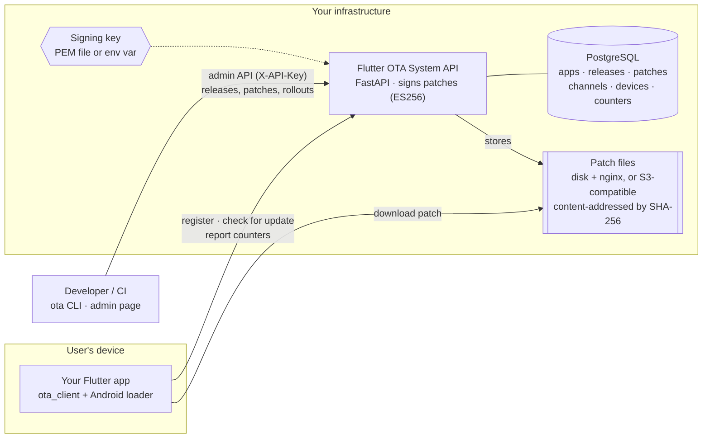
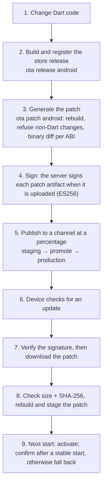

<p align="center">
  
</p>

<h1 align="center">Flutter OTA System</h1>

<h3 align="center">Your Flutter OTA infrastructure. Your servers. Your control.</h3>

<p align="center">
  An open-source, self-hosted over-the-air (OTA) update platform for Flutter applications.
</p>

<p align="center">
  <a href="LICENSE"></a>
  <a href="#current-status"></a>
  <a href="#why-flutter-ota-system"></a>
  <a href="https://github.com/punitsoni22/flutter_ota_system/releases"></a>
  <a href="https://github.com/punitsoni22/flutter_ota_system/actions/workflows/ci.yml"></a>
  <br>
  
  
  
</p>

<p align="center">
  <a href="#quick-start">Quick start</a> ·
  <a href="docs/why-flutter-ota-system.md">Why self-hosted?</a> ·
  <a href="#flutter-ota-system-vs-shorebird">vs Shorebird</a> ·
  <a href="docs/community/testing-guide.md">Help us test</a> ·
  <a href="docs/index.md">Docs</a>
</p>

> [!WARNING]
> **Experimental alpha (v0.1.0-alpha.1).** Flutter OTA System has been tested internally on
> **Linux** and a **small number of Android devices** only. It has **not** been independently
> security-audited, load-tested or validated in production. It distributes code that your app
> will run: a mistake in how you operate it, or a bug in it, can break apps in the field. **Do not
> use it for production OTA delivery** until you have validated its security, reliability,
> compatibility, rollback, signing and recovery for your own apps. Use at your own risk
> ([Apache-2.0](LICENSE), sections 7 and 8: no warranty, no liability).

## Why Flutter OTA System?

A Flutter fix normally needs a new store build, a store review and users who update. OTA patches
shorten that loop. They also put a server in charge of **what code runs in your users' apps**,
and that server receives a request from every install that checks for updates.

If that server belongs to a third party, so do some important decisions:

- where update-check data goes;
- where your builds and patches are stored;
- how rollouts behave;
- how much you pay as your install count grows.

For many teams, a managed service is the right trade. Flutter OTA System is for teams that need
those pieces **on their own infrastructure**:

- 🏠 **Self-hosted deployment.** One command starts the server, database and file server with
  Docker Compose. It runs on your machine or server, and there is no hosted service.
- 🔐 **Infrastructure ownership.** Your FastAPI server, your PostgreSQL database, your disk or
  S3-compatible bucket, and your ES256 signing key, which never leaves your server.
- 📊 **Data control.** Devices talk only to the URLs you configure. Update checks, device
  records and patch counters stay in your database.
- 🛠️ **A backend you can change.** The update-check rules, rollout bucketing and promotion
  checks are short, readable Python. Fork them and adapt them to your requirements.
- 📖 **Open-source freedom.** Apache-2.0: use it, fork it, modify it and integrate it. There is
  no subscription, but you pay for and operate your own infrastructure.

Longer explanation, including when **not** to use it:
[docs/why-flutter-ota-system.md](docs/why-flutter-ota-system.md).

## Flutter OTA System vs Shorebird

[Shorebird](https://shorebird.dev/) is the established code push solution for Flutter. It is
mature, supports more platforms, and is run as a managed service. Several of its parts are open
source: the CLI, the client libraries, the updater and its Flutter fork. Its hosted backend is
not offered for self-hosting. The two projects take **different architectural approaches**:

| | Flutter OTA System | Shorebird |
|---|---|---|
| **Self-hosted deployment** | ✅ The only option (Docker Compose) | ❌ "No plans to offer on-premises or self-hosted versions" ([FAQ](https://docs.shorebird.dev/code-push/faq/)) |
| **Managed hosting** | ❌ None. You run it | ✅ Hosted on Google Cloud, US regions by default ([architecture](https://docs.shorebird.dev/code-push/system-architecture/)) |
| **Backend ownership** | Your server; source in this repo (Apache-2.0) | Operated by Shorebird. CLI, updater and client libraries are open source (Apache-2.0/MIT) ([GitHub](https://github.com/shorebirdtech/shorebird)) |
| **Database ownership** | Your PostgreSQL | Shorebird's hosted database |
| **Artifact storage** | Your disk + nginx, or your S3-compatible bucket | Shorebird's storage; patches served through its global CDN |
| **Backend customisation** | Modify update-check, rollout and targeting code | Configured through its console, CLI and tracks |
| **Patch signing** | ES256; key on your server (file or env var; no KMS yet) | RSA; managed in Google Cloud KMS by default, or your own key ([docs](https://docs.shorebird.dev/code-push/guides/patch-signing/)) |
| **Percentage rollouts** | Built in, deterministic, with server-side promotion checks | Built from tracks plus your own app logic ([guide](https://docs.shorebird.dev/code-push/guides/percentage-based-rollouts/)) |
| **Pricing model** | Free software; you pay for your servers, storage and time | Free tier (5,000 patch installs/month), then $20, $400 or custom per month ([pricing](https://shorebird.dev/pricing), 2026-11-11) |
| **Flutter patch engine** | Stock Flutter, Android only: swaps the AOT library at start (experimental) | Flutter fork; compiled patches on Android/desktop, a Dart interpreter on iOS ([architecture](https://docs.shorebird.dev/code-push/system-architecture/)) |
| **Platforms** | Android code patches; iOS **not** implemented | Android, iOS, macOS, Windows, Linux ([FAQ](https://docs.shorebird.dev/code-push/faq/)) |
| **Maturity** | Alpha (v0.1.0-alpha.1), no security audit | 1.0 since April 2024; company-backed, with customer stories on its website ([shorebird.dev](https://shorebird.dev/)) |
| **Platform testing** | Linux + a small number of Android 13 devices | Production use reported by the vendor |

**Choose Shorebird** if you need iOS, a production-proven service, or don't want to run servers.
**Consider Flutter OTA System** if your OTA infrastructure must run on servers you control and
you can validate and operate it yourself. Shorebird facts were checked against its official
pages on 2026-11-11; [tell us](https://github.com/punitsoni22/flutter_ota_system/issues) if
something changed.

## Key features

| Feature | What it does | Status |
|---|---|---|
| **Release management** | Register each store build (`android 1.0.0+1`); a patch belongs to exactly one release and never crosses versions | ✅ Tested |
| **Signed patches** | The server signs a canonical message (app, release, patch number, platform, arch, format, hashes, size) with ES256. The app verifies it **before** downloading, then checks size and SHA-256 | ✅ Tested |
| **Channels** | `dev`, `staging`, `production`; add your own through the API | ✅ Tested |
| **Staged rollouts** | Deterministic, sticky percentage buckets: raising 1% → 10% keeps the first 1% | ✅ Tested |
| **Promotion checks** | The server refuses to grow a patch on `production` unless it ran on another channel first without boot failures. Overrides need a logged reason | ✅ Tested |
| **Rollback and revoke** | Roll back to the previous patch, or revoke one permanently, from the server | ✅ Tested |
| **Boot protection** | A patch that does not confirm a successful start is skipped; the app returns to its last good code, and the server stops offering that patch to the device | ✅ Tested |
| **Compatibility checks** | Release, platform, CPU architecture and patch format are matched before any rollout decision; no older patch is offered unless the current one is bad | ✅ Tested |
| **Device registration and telemetry** | Devices register per app; per-patch counters (downloaded, staged, boot ok/failed) and a device summary per release, channel and patch | ✅ Tested (counters only; no dashboards) |
| **Android Dart code patches** | Change Dart code, run `ota patch android`, and phones run it after the next restart. Stock Flutter, no engine fork; non-Dart changes are refused | 🟡 Experimental |
| **Config patches (`mock-v1`)** | Signed JSON or other files that the app reads at start | ✅ Tested |
| **Self-hosting** | `./flutter-ota-system.sh`: setup, status, logs, backup/restore, demo, reset | ✅ Linux · 🟡 single-server `deploy/` not verified |
| **Admin page and CLI** | A static admin page at `/admin`; the `ota` CLI for apps, releases, patches and rollouts | 🟢 Admin page partially tested · ✅ CLI |

✅ implemented and tested (automated tests and/or the CI end-to-end demo) · 🟢 implemented,
partially tested · 🟡 experimental · Not implemented: iOS code patches, RBAC/SSO/audit log,
KMS/HSM signing, rate limiting, dashboards and alerts
([roadmap](docs/roadmap/README.md#planned--not-implemented)).

## Architecture



- **Control plane:** the API decides which patch a device gets and signs patch metadata. It never
  streams patch bytes.
- **Data plane:** immutable patch files on your disk (served by nginx) or in your S3-compatible
  bucket.
- **Client:** `ota_client` verifies, stages and activates patches, and falls back to the last good
  code. On Android, a small Java class points Flutter's loader at the verified Dart library at
  process start.

Details: [docs/architecture.md](docs/architecture.md) · terms: [docs/concepts.md](docs/concepts.md).

## How it works



1. **Change code** in your app. A store release is the exact APK/AAB that `ota release android`
   built and registered. You ship that file through the store as usual.
2. **Generate a patch** with `ota patch android`. The CLI rebuilds your app and compares it with
   the release fingerprint. It refuses changes to native libraries, `.dex` code, the manifest,
   resources, assets or the Flutter version. It then uploads one binary diff of `libapp.so` per
   ABI.
3. **Sign:** the server stores each file under its SHA-256 and signs its metadata.
4. **Publish** to a channel at a percentage, then promote and raise the rollout.
5. **The device** checks, verifies the signature against the public keys compiled into the app,
   and downloads the file. It checks size and SHA-256, rebuilds and stages the patch, and
   activates it on the next start.
6. **Something wrong?** If a patched start is not confirmed, the app falls back by itself. You can
   also `rollback` or `revoke` from the server.

Config patches (`mock-v1`) follow the same path, with `ota patch create` and a file instead of
steps 1–2. Full walkthrough: [docs/releases-and-patches.md](docs/releases-and-patches.md).

## Quick start

Requires Linux with Git, curl and Docker with Compose v2.20+, and free ports 8000 and 8080.
Takes about 10 minutes. macOS and Windows are not tested.

```bash
git clone https://github.com/punitsoni22/flutter_ota_system.git
cd flutter_ota_system
./flutter-ota-system.sh setup     # creates .env (random LOCAL secrets), builds, creates a LOCAL dev signing key,
                                  # starts the stack, waits for health checks, prints the URLs
./flutter-ota-system.sh demo      # demo app + release android 1.0.0+1, a signed mock-v1 test patch on
                                  # 100% of dev, then end-to-end checks (exits non-zero on any failure)
```

Expected last line:

```
RESULT: all checks passed (artifact pipeline; mock-v1 does not execute code)
```

Then:

- open the admin page at <http://localhost:8000/admin> (key: `OTA_ADMIN_API_KEY` from `.env`);
- open the API docs at <http://localhost:8000/docs>;
- see the patch arrive on an Android phone with the example app, and try rollback, crash
  protection and rollouts: [docs/installation.md](docs/installation.md).

`./flutter-ota-system.sh setup` is safe to re-run: it never overwrites `.env`, the database or the
signing key. Other commands:

- `./flutter-ota-system.sh help` lists every command;
- `./flutter-ota-system.sh stop` stops the stack and keeps everything;
- `./flutter-ota-system.sh reset` deletes the local database, files and dev key after you confirm.

### In your app and on your machine

```dart
final client = OtaClient(OtaConfig(
  serverUrl: 'https://ota.example.com',
  appSlug: 'my-app',
  releaseVersion: '${info.version}+${info.buildNumber}',   // from package_info_plus
  publicKeys: {'prod-1': '<uncompressed_point_base64 from `ota key show`>'},
  runtime: AotPatchRuntime(),
));
await client.boot();                                        // never throws
client.markBootSuccessfulAfterFirstFrame(stableFor: const Duration(seconds: 5));
await client.checkForUpdate();                              // never throws; returns an UpdateResult
```

```bash
ota app create my-app "My App"
ota release android my-app -- --dart-define=OTA_SERVER_URL=https://ota.example.com …   # store build
# change Dart code, then:
ota patch android my-app --channel staging --note "fix checkout total"
ota patch promote <patch_id> --percent 1                                              # canary
ota patch rollout <patch_id> --channel production --percent 100
ota patch rollback <patch_id>                                                         # undo
```

Full guide: [docs/flutter-integration.md](docs/flutter-integration.md).

## Community testing

> ### 🧪 Help us build an open-source alternative for self-hosted Flutter OTA updates.
>
> We have tested on one Linux setup and a few Android 13 phones. **Your machine, your phone and
> your Flutter version** are exactly what we have not seen yet.

You can help by:

1. **Installing Flutter OTA System** with the [quick start](#quick-start).
2. **Testing the Android OTA workflow** with the
   [testing guide](docs/community/testing-guide.md). It has 13 areas, from a fresh Docker install
   to device registration, patch generation, signature checks, activation, crash recovery and
   rollback.
3. **Reporting what happened** with a
   [Test report](https://github.com/punitsoni22/flutter_ota_system/issues/new?template=test_report.yml).
   "Everything worked on my Pixel 6 / Android 14 / Flutter 3.x" is a valuable report.
4. **Reporting bugs** with the
   [Bug report](https://github.com/punitsoni22/flutter_ota_system/issues/new?template=bug_report.yml)
   form, with your environment and logs (secrets removed).
5. **Suggesting features** with a
   [feature request](https://github.com/punitsoni22/flutter_ota_system/issues/new?template=feature_request.yml).
6. **Improving the documentation**: unclear steps are bugs too.
7. **Submitting pull requests**: start with [CONTRIBUTING.md](CONTRIBUTING.md).

Especially wanted:

- Android versions other than 13, and other manufacturers;
- `armeabi-v7a` and `x86_64` builds;
- other Flutter versions;
- macOS or Windows hosts;
- other Linux distributions;
- your own app with `ota_client`.

## Current status

- **Experimental alpha** (v0.1.0-alpha.1). APIs, the database schema and patch formats may change
  before 1.0, without migration paths.
- **Internally tested on Linux and Android only**, on a small number of devices.
- **iOS, macOS and Windows: not tested.** iOS code patches are not implemented.
- **Not production-validated.** Independent security review, device-compatibility testing and
  scalability testing are still required. No load tests have been run, and no capacity is
  claimed.

## Platform Support & Testing Status

> [!NOTE]
> Code that may support a platform is not the same as a tested platform. Anything not marked
> "Internally tested" below is untested and used at your own risk.

| Platform | Testing status | Notes |
|---|---|---|
| Linux development environment | Internally tested | Ubuntu, Docker Engine + Compose v2. Backend, CLI and `scripts/verify_demo.sh` |
| Android Flutter application | Internally tested | `mock-v1` config patches and experimental Android Dart code patches, on a small number of devices |
| iOS | Not tested | Needs macOS + Xcode. iOS code patches are not implemented. `mock-v1` is pure Dart and might work, but is untested |
| macOS | Not tested | Neither as a development machine nor as a Docker Desktop host |
| Windows | Not tested | Neither as a development machine nor as a Docker Desktop host |

Android testing does **not** establish compatibility with every Android device, OS version, CPU
architecture (ABI) or Flutter version. No device compatibility matrix is published.

Flutter: `ota_client` analysis and unit tests ran with Flutter 3.44 stable. The package requires
Flutter ≥ 3.27 and Dart ≥ 3.12; other Flutter versions are not tested.

| Area | State in v0.1.0-alpha.1 |
|---|---|
| Control plane (FastAPI + PostgreSQL) | Working, internally tested, automated tests |
| Signed patch metadata (ES256) + SHA-256 | Working, covered by tests and `scripts/verify_demo.sh` |
| Channels, percentage rollout, rollback, revoke | Working, internally tested |
| `mock-v1` config patches | Working; used by the local demo |
| Android Dart code patches (`aot-bidiff-android-v1`, stock Flutter) | **Experimental.** Internally tested on a small number of devices |
| iOS code patches | **Not implemented.** iOS is not tested at all |
| Local Docker stack | Working; tested by the maintainers on Linux only (macOS/Windows not tested) |
| Single-server Docker deployment (`deploy/`) | **Draft, not yet verified end to end** |
| Storage | Local disk + nginx, or S3-compatible buckets. **No Azure Blob** |
| Signing key | Local PEM file or env var. **No Key Vault / KMS / HSM** |
| Users, roles (RBAC), audit log | **Not implemented**: one shared admin API key |
| Redis / caching | **Not used** |
| Scale | **No load tests.** 1M active installs is a roadmap design goal only, not a tested capacity |

Full breakdown: [docs/limitations.md](docs/limitations.md) · roadmap:
[docs/roadmap/](docs/roadmap/README.md).

## Technology stack

| Part | Technology |
|---|---|
| Server | Python 3.13, FastAPI, Uvicorn, SQLAlchemy 2, Alembic, PyJWT, `cryptography`, boto3 |
| Database | PostgreSQL 17 (SQLite only for tests) |
| File serving | nginx (local disk) or any S3-compatible bucket; Caddy for HTTPS in the single-server setup |
| Client | Dart / Flutter package `ota_client` (`crypto`, `pointycastle`, `http`, `path_provider`) + an Android part in Java 17 |
| Tooling | Python CLI `ota` (`httpx`, `bsdiff4`), Bash scripts, Docker Compose, GitHub Actions |

## Documentation

Everything is indexed in [docs/index.md](docs/index.md):

| | |
|---|---|
| Tutorial | [Installation](docs/installation.md) · [Testing guide](docs/community/testing-guide.md) |
| How-to | [Flutter integration](docs/flutter-integration.md) · [Releases and patches](docs/releases-and-patches.md) · [Rollouts](docs/rollouts.md) · [Operations](docs/operations.md) · [Troubleshooting](docs/troubleshooting.md) |
| Reference | [API](docs/api-reference.md) · [CLI](docs/cli-reference.md) · [Configuration](docs/configuration.md) |
| Explanation | [Why Flutter OTA System?](docs/why-flutter-ota-system.md) · [Concepts](docs/concepts.md) · [Architecture](docs/architecture.md) · [Security](docs/security.md) · [Limitations](docs/limitations.md) · [Roadmap](docs/roadmap/README.md) |

## Known limitations

- Alpha: the API, database schema and patch formats may change without migration paths.
- Android code patches:
  - change Dart code only;
  - need the exact registered store build and the same Flutter version;
  - depend on Flutter internals.

  There are no iOS code patches.
- Only Linux (development) and Android (app) are internally tested
  ([details](#platform-support--testing-status)).
- One shared admin API key; no users, roles, SSO or audit log.
- Device registration is open, and there is no rate limiting. Patch files are public by hash, so
  never put secrets in patches.
- The signing key is a file or an environment variable. There is no Key Vault, KMS or HSM, and no
  key-rotation tooling.
- Devices learn about patches, rollbacks and revocations only when the app checks.
- No dashboards, alerts or automatic rollout pausing; no load tests.
- The Android application ID and Java package use `dev.flutterota.*`. Ownership of the domain
  `flutterota.dev` has **not** been confirmed, so these identifiers may change before a stable
  release. Use your own application ID in your apps.

More: [docs/limitations.md](docs/limitations.md). Known bugs: [docs/known-issues.md](docs/known-issues.md).

## Security

Read [docs/security.md](docs/security.md) before deploying anything. Report vulnerabilities
privately as described in [SECURITY.md](SECURITY.md), **never in public issues**.

## Contributing

Contributions are welcome: test reports, bug reports, tests, documentation and careful fixes.
Read [CONTRIBUTING.md](CONTRIBUTING.md) and the [Code of Conduct](CODE_OF_CONDUCT.md).

## Licence

Apache License 2.0. See [LICENSE](LICENSE), [NOTICE](NOTICE) and
[THIRD_PARTY_NOTICES.md](THIRD_PARTY_NOTICES.md). Copyright The Punit Authors.

Flutter OTA System is not affiliated with or endorsed by Google, the Flutter project or Shorebird.
"Flutter" is a trademark of Google LLC.
