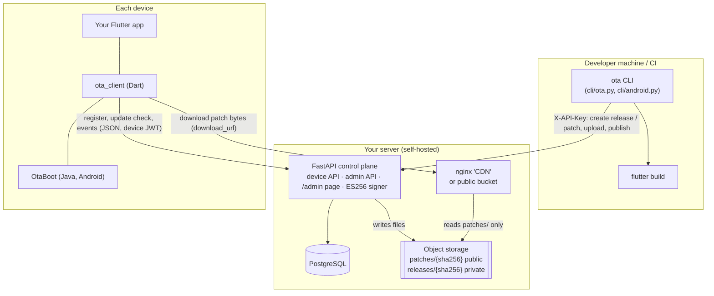
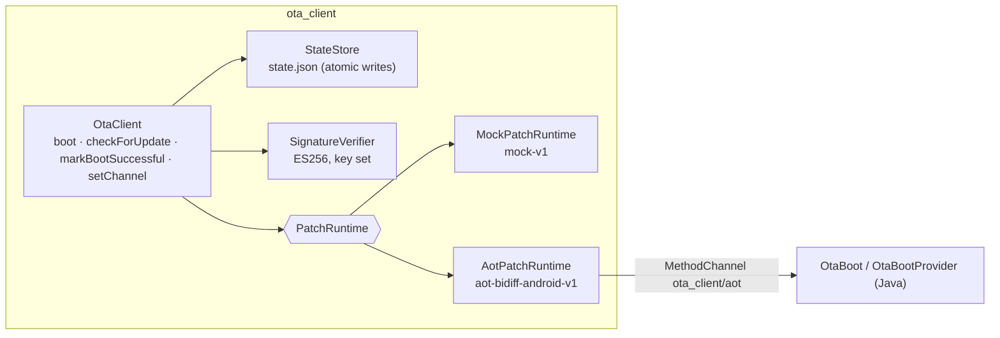
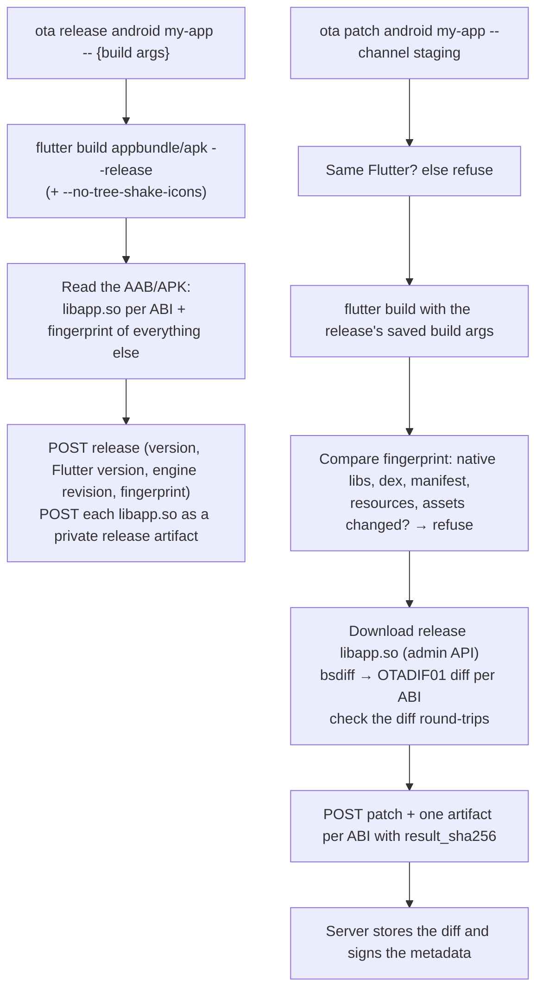
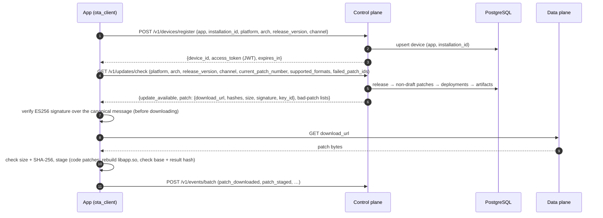
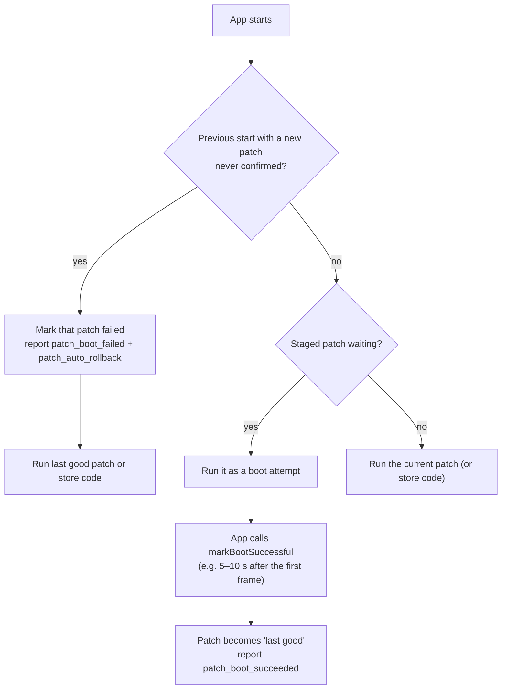
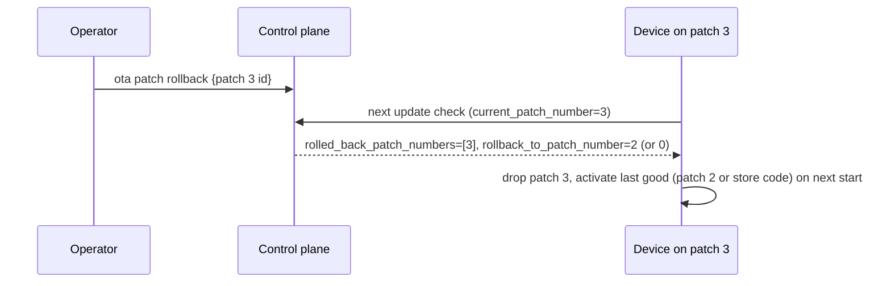
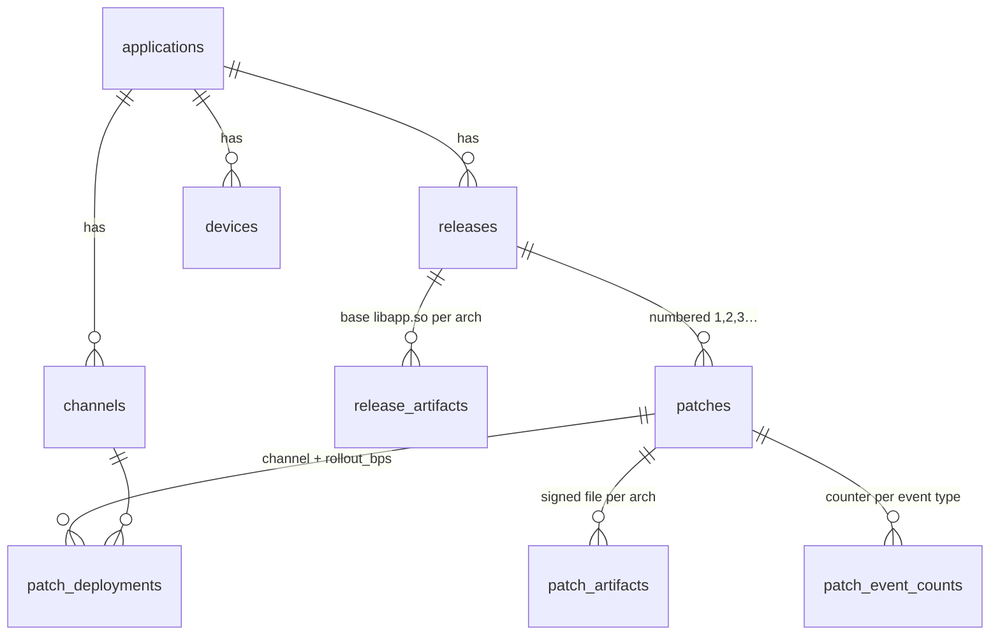

# Architecture

> Applies to v0.1.0-alpha. Punit is experimental and has only been tested internally, on a Linux
> development machine and with Android apps. iOS, macOS and Windows are not tested
> ([testing status](../README.md#platform-support--testing-status)). See the
> warning in the [README](../README.md). Words like *release*, *patch* and *channel* are defined in
> [concepts.md](concepts.md).

## The three parts

Punit has three parts. Keeping them apart is the main design idea.

| Part | Job | Where it runs | Code |
|---|---|---|---|
| **Control plane** | Decides *which* patch a device should run, signs patch metadata, stores state | Your server | FastAPI app in [`backend/app/`](../backend/app/), PostgreSQL |
| **Data plane** (artifact distribution) | Serves patch **bytes** | Your server or a bucket/CDN | nginx container locally ([`docker/nginx-cdn.conf`](../docker/nginx-cdn.conf)), or any S3-compatible bucket |
| **Runtime** (patch engine) | Verifies, stages and runs a patch on the phone | Each device | [`packages/ota_client/`](../packages/ota_client/) (Dart + an Android Java part) |

The control plane answers small JSON requests. It never streams patch files to devices: it hands
out a URL, and the data plane serves the file. The runtime trusts neither of them: it checks the
signature and hashes itself.

**On the server:** FastAPI, PostgreSQL, storage and the file server. **On each device:**
`ota_client` and, for Android code patches, the `OtaBoot` Java class inside the same plugin.
**On the developer machine:** the `ota` CLI, which builds the app, computes diffs and talks to the
admin API. There is no separate patch-engine service and no background worker.

## Backend (control plane)

| Module | Responsibility |
|---|---|
| [`main.py`](../backend/app/main.py) | App factory, health endpoints, `/admin` page, startup: production safety checks, migrations, signing key |
| [`config.py`](../backend/app/config.py) | All settings from `OTA_*` environment variables ([configuration.md](configuration.md)) |
| [`routers/devices.py`](../backend/app/routers/devices.py) | Device API: register, update check, events |
| [`routers/admin.py`](../backend/app/routers/admin.py) | Admin API: apps, channels, releases, patches, rollouts, signing key |
| [`updates.py`](../backend/app/updates.py) | The update-check decision (the hot path) |
| [`bucket.py`](../backend/app/bucket.py) | Deterministic rollout buckets |
| [`canonical.py`](../backend/app/canonical.py), [`signing.py`](../backend/app/signing.py) | The signed message and the ES256 signer |
| [`storage.py`](../backend/app/storage.py) | Content-addressed storage: local disk or S3-compatible |
| [`auth.py`](../backend/app/auth.py) | Admin API key and device JWTs |
| [`models.py`](../backend/app/models.py), [`migrations/`](../backend/migrations/) | Database tables and Alembic migrations |

On startup the API: (1) refuses to start if `OTA_ENV=production` and a setting is unsafe,
(2) takes a PostgreSQL advisory lock, (3) runs Alembic migrations, (4) loads the signing key. The
lock stops several Uvicorn workers from migrating or creating a key at the same time.

## Flutter client architecture

- **`OtaClient`** ([`ota_client.dart`](../packages/ota_client/lib/src/ota_client.dart)) runs the
  whole flow: boot protection, update check, download, verification, staging and telemetry.
- **`PatchRuntime`** ([`runtime.dart`](../packages/ota_client/lib/src/runtime.dart)) is the only
  part that knows how a patch is executed ([ADR-0001](adr/0001-runtime-abstraction.md)). Two
  implementations exist:
  - `MockPatchRuntime`: the payload is an inert file the app reads (`activePayload`).
  - `AotPatchRuntime` ([`aot_runtime.dart`](../packages/ota_client/lib/src/aot_runtime.dart)):
    Android code patches. It is a `NativeBootRuntime`: native code picks the code to run before
    Dart starts.
- **State** ([`state.dart`](../packages/ota_client/lib/src/state.dart)) lives in one JSON file in
  the app's support directory, written atomically (temp file + rename). It holds the installation
  id, device token, active / staged / last good patch, failed patch ids, the highest accepted
  patch number and pending telemetry events.

## Patch engine and Flutter integration (Android code patches)

> 🟡 **Experimental.** Tested internally on a small number of devices. Android only.

Punit does **not** modify or fork the Flutter engine. It uses an option that stock Flutter
already has: the engine can load the app's compiled Dart code (`libapp.so`) from a path given by
`--aot-shared-library-name`.

1. The plugin's manifest registers a content provider, `OtaBootProvider`, which Android starts
   when the app process starts, **before** `Application.onCreate` and before any Flutter engine.
2. It calls `OtaBoot.prepare()`
   ([`OtaBoot.java`](../packages/ota_client/android/src/main/java/dev/flutterota/ota_client/OtaBoot.java)).
   In a **release** build (debug builds run Dart in JIT mode and are skipped), it reads
   `boot.json`, which the Dart side wrote. That file names the `next` patch to try and the last
   `good` one.
3. It re-checks the chosen file's size and SHA-256, then tells `FlutterLoader` to load it. Every
   Flutter engine in the process (UI, push handlers, background jobs) then runs the same code.
4. If anything is wrong, the store code runs. `OtaBoot` never throws.

Because this hooks into Flutter's loader, it depends on Flutter internals. A patch must be built
with **exactly** the Flutter version of its release, and the CLI enforces that.

### Patch compilation and generation

Patches are built on the developer machine by the CLI ([`cli/android.py`](../cli/android.py)),
never on the server.

The diff format `OTADIF01` is bsdiff's control/diff/extra blocks, each zlib-compressed. Python
writes it ([`cli/otadiff.py`](../cli/otadiff.py), using the `bsdiff4` package) and Dart applies it
([`bsdiff.dart`](../packages/ota_client/lib/src/bsdiff.dart)).

## Artifact storage and CDN

- Every file is stored under `<kind>/<sha256>` and never overwritten. Uploading the same bytes
  again reuses the existing file.
- `patches/` is **public**: devices download from `OTA_CDN_BASE_URL/patches/<sha256>`.
  Integrity comes from the signature, not from secret URLs.
- `releases/` is **private**: it holds the store build's compiled code. Only the admin API
  serves it (to the CLI, for diffing). The nginx config and the Caddy config return 404 for
  anything under `/cdn/` other than `/cdn/patches/`.
- Two backends: `LocalStorage` (disk; nginx serves it) and `S3Storage` (two buckets on any
  S3-compatible service). Azure Blob Storage is **not implemented**.
- Patch files are served with `Cache-Control: public, max-age=31536000, immutable`.

## Device registration and the update check

The server's decision in [`updates.py`](../backend/app/updates.py), in order:

1. Find the release by (application, platform, version). Unknown release → "no update".
2. Load the release's non-draft patches. Build the `rolled_back_patch_numbers` and
   `revoked_patch_numbers` lists; **every** response carries them, even "no update".
3. Keep patches that are `published`, in a supported format, not in the device's
   `failed_patch_ids`, deployed to the device's channel, with an artifact for its arch, and whose
   rollout bucket includes the device.
4. Pick the highest patch number. If the device's current patch is rolled back or revoked, set
   `rollback_to_patch_number` (0 = store code).
5. Never offer a patch lower than the current one unless the current one is bad (anti-replay).

The server updates the device row (release, channel, patch number) only when something changed,
or at most once an hour. There is no separate heartbeat endpoint.

## Download, verification and activation

On the device, in order ([`ota_client.dart`](../packages/ota_client/lib/src/ota_client.dart)):

1. Refuse patches that already failed here, replays, wrong arch, wrong `runtime_abi`, an
   unsupported format, or an unknown `key_id`.
2. Rebuild the canonical message from the response and the device's own platform/arch and
   **verify the ES256 signature before downloading**.
3. Download, stopping if more than `size_bytes` arrive. Check the exact size and the SHA-256.
4. Stage: `mock-v1` moves the file into the patch folder; the Android runtime rebuilds
   `libapp.so` from the store copy + diff, checking the base hash and the result hash.
5. The patch becomes active on the **next app start**. Running code is never swapped live.

### Patch activation and boot protection

- **`mock-v1`:** the Dart client does this in `OtaClient.boot()` and re-checks the payload hash
  from disk before each use.
- **Code patches:** `OtaBoot` does it natively, because a broken patch may never reach Dart. It
  records an attempt only when an Activity starts, so a process woken for a push message or a
  background job is never counted as a failure.
- Crashes **after** the patch was confirmed are not detected. Use server rollback for those.

## Rollback flow

## Database

Nine tables, defined in [`models.py`](../backend/app/models.py) and created by Alembic migrations
in [`backend/migrations/versions/`](../backend/migrations/versions/):

Key constraints: `releases (application_id, platform, version)` unique; `patches (release_id,
number)` unique; `patch_deployments.rollout_bps` between 0 and 10000; one device row per
`(application_id, installation_id)`. Telemetry is stored only as **counters** per patch and event
type. There is no per-device event history.

Migrations run automatically on API startup. To add a schema change, add an Alembic revision.

## Security architecture (summary)

| Layer | Mechanism |
|---|---|
| Patch integrity and origin | ES256 signature over a canonical message + SHA-256, verified on the device with keys compiled into the app |
| Device API | Per-device HS256 JWT |
| Admin API | One shared `X-API-Key` |
| Transport | HTTPS is your responsibility (the production compose uses Caddy). Production startup requires an `https://` CDN URL |
| Store builds | Private storage, admin API only |

Details, threat model and gaps: [security.md](security.md).

## What runs where (summary)

| Runs on | Components |
|---|---|
| Your server | FastAPI (Uvicorn, 2 workers by default), PostgreSQL 17, nginx file server; Caddy in the single-server deploy |
| Object storage (optional) | S3-compatible public + private buckets |
| Developer machine / CI | `ota` CLI, Flutter SDK, Python 3 |
| Each device | Your app + `ota_client` (Dart) + `OtaBoot` (Android, Java) |

Not part of Punit today: Redis, message queues, Azure services, Kubernetes manifests, a metrics
stack. See [limitations.md](limitations.md) and the [roadmap](roadmap/README.md).
