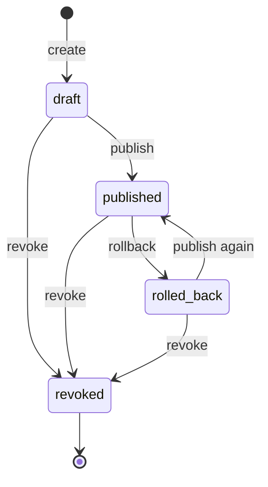
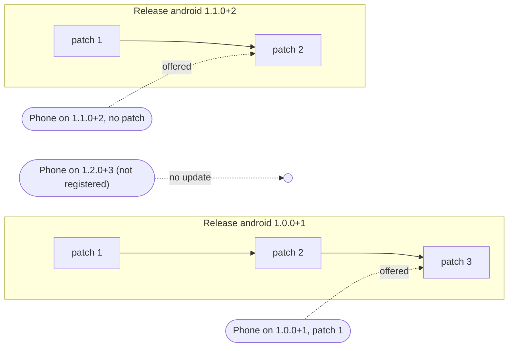

# Core concepts

This page explains the words Punit uses and the rules behind them. Read it before
[releases-and-patches.md](releases-and-patches.md) and [rollouts.md](rollouts.md).

## Application

An **application** is one app on the server, identified by a **slug** (lowercase letters, digits
and dashes, 3–100 characters, e.g. `shop-app`). The slug is what the app sends when it registers.

Each application has a **distribution** type:

| `distribution` | Meaning | Effect |
|---|---|---|
| `enterprise` (default) | Installed in-house / through MDM | Android code patches can be published at once |
| `public_store` | Published on Google Play | Android code patches are refused until someone records a policy approval with `ota app approve-policy` ([why](flutter-integration.md#store-policy)) |

## Full release (store build)

A **release** is one build of your app that you ship through a store or install directly, for one
platform. It is identified by `platform` + `version`, where `version` is the **full** Flutter
version including the build number, exactly as `pubspec.yaml` defines it: `1.0.0+1`.

`1.0.0+1` and `1.0.0+2` are **two different releases**. A release is the *base* that patches are
built for, so in this documentation "full release", "store build" and "base release" mean the same
thing.

A release used for Android code patches also stores:

- its compiled Dart code (`libapp.so`) per CPU architecture, kept **private** on the server;
- a **fingerprint**: the Flutter version, build arguments, and hashes of everything a patch must
  not change (native libraries, Java/Kotlin code, manifest, resources, assets).

## OTA patch

A **patch** is an update delivered over the air to **exactly one release**. Patches are numbered
per release: 1, 2, 3, …. A patch has one file (an **artifact**) per CPU architecture.

Each patch has an **artifact format**:

| Format | What the file is | Status |
|---|---|---|
| `mock-v1` | An inert file (for example JSON) that the app reads at start. No code runs | ✅ Implemented. Used by the demo |
| `aot-bidiff-android-v1` | A binary diff of the Android `libapp.so` (the app's compiled Dart code) | 🟡 Experimental, Android only |
| `evc-v1` | Reserved name for a future iOS approach | 🔭 Not implemented; no client runtime supports it |

### A patch is always "base + diff", never "patch on patch"

Each patch is built against the **store build**, not against the previous patch. A phone on
patch 1 that is offered patch 4 downloads only patch 4. It never needs 2 and 3.

### Patch states

- **draft**: files can still be added. Devices never see drafts.
- **published**: offered to devices on the channels it is deployed to.
- **rolled_back**: devices on it move away from it. It can be published again.
- **revoked**: final. It never runs again anywhere.

## Patch compatibility

The server offers a patch to a device only if **all** of these match. They are checked in
[`backend/app/updates.py`](../backend/app/updates.py):

| Check | Device sends | Must match |
|---|---|---|
| Application | its token (from registration) | the patch's application |
| Release | `platform` + `release_version` | the patch's release, exactly |
| Architecture | `arch` (e.g. `arm64-v8a`) | an artifact of the patch |
| Format | `supported_formats` | the patch's format |
| Channel | `channel` | a deployment of the patch |
| Rollout | (its installation id) | its rollout bucket is inside the percentage |

The device then checks again before it installs anything: the signature, the hashes, the
`runtime_abi` and the format ([security.md](security.md#device-side-checks)).

For Android code patches the **CLI** adds build-time checks: same Flutter version as the release,
and no change outside Dart code ([releases-and-patches.md](releases-and-patches.md#what-a-code-patch-can-change)).

## Versioning: several releases, each with its own patches

Patches never cross releases. This is the main safety rule.

| Situation | Result |
|---|---|
| Phone on `1.0.0+1`, patches 1–3 published | Gets patch **3** directly |
| New install of `1.0.0+1` after patch 3 was published | Gets patch 3 on its first check |
| Phone updated from the store to `1.1.0+2` | Starts fresh on `1.1.0+2`. Never sees `1.0.0+1` patches. Its old patches are deleted locally |
| Phone on a version the server does not know | "No update". It runs its store code |
| Server down or phone offline | The app runs its current good code. OTA never blocks startup |

## Channel

A **channel** is a named audience. New applications get three: `dev`, `staging` and
`production`. You can add more (for example `qa`) through the API
([rollouts.md](rollouts.md#channels)).

A device's channel comes from the app: `OtaConfig.channel` (default `production`), which a tester
build can change with `--dart-define=OTA_CHANNEL=staging` or at runtime with
`OtaClient.setChannel()`. The server trusts what the device says.

A patch is **deployed** to one or more channels, each with its own rollout percentage.

## Device registration

On its first check, the app registers itself (`POST /v1/devices/register`). It sends the app
slug, a random **installation id** (created once and stored on the device), platform, CPU
architecture, release version and channel. The server answers with a **device token** (a JWT,
valid 30 days by default). The client re-registers automatically when the token is rejected.

Registration is open to anyone who knows the app slug. The token limits what a device can see; it
does not prove that the caller is a genuine install ([security.md](security.md)).

## Staged rollout

A patch can reach only a **percentage** of a channel, from 0 to 100 in steps of 0.01%. Each
device gets a fixed **bucket** from 0 to 9999, computed from a server secret, the application id,
the installation id and the **patch id**. A device is in the rollout when its bucket is below the
percentage × 100.

- Raising the percentage of a patch only **adds** devices. Devices already in stay in.
- Each patch has its **own** buckets, so the 10% that got patch 3 is not the same 10% that gets
  patch 4.
- Changing `OTA_ROLLOUT_HMAC_SECRET` reshuffles every bucket.

## Canary deployment

Punit has no separate canary feature. You get the same effect with what exists:

1. a **channel** such as `staging` that only tester builds use, and/or
2. a **small percentage** (1–5%) of `production` first.

Watching the canary is manual: read the boot success/failure counts per patch on the admin page.
There is no automatic pause or promotion ([rollouts.md](rollouts.md)).

## Device targeting

Targeting is limited to what the update check already knows: **application, release, platform,
architecture, channel and rollout percentage**. Targeting by country, device model, user id or
custom attributes is **not implemented** ([roadmap Phase 7.5](roadmap/phase-07-rollout.md#75-targeting-optional-small)).

## Rollback

**Rollback** (`ota patch rollback <id>`) marks a published patch `rolled_back`. On their next
check, devices running it are told to go back to the newest **other** patch they are eligible
for, or to the store code (`rollback_to_patch_number: 0`). The change takes effect on the next
app start. The patch can be published again later.

There is also an automatic, **device-side** rollback: if a newly installed patch never confirms a
successful start, the next start runs the last good code instead and reports `patch_boot_failed`
([architecture.md](architecture.md#patch-activation-and-boot-protection)).

## Revocation

**Revoke** (`ota patch revoke <id>`) is permanent. The patch number appears in the
`revoked_patch_numbers` list of every update-check response for that release, and clients drop it
even if they already downloaded it. Like rollback, it reaches a device on its next check.

## Where to go next

- How the pieces fit: [architecture.md](architecture.md)
- Try it locally: [installation.md](installation.md)
- Ship a release and a patch: [releases-and-patches.md](releases-and-patches.md)
