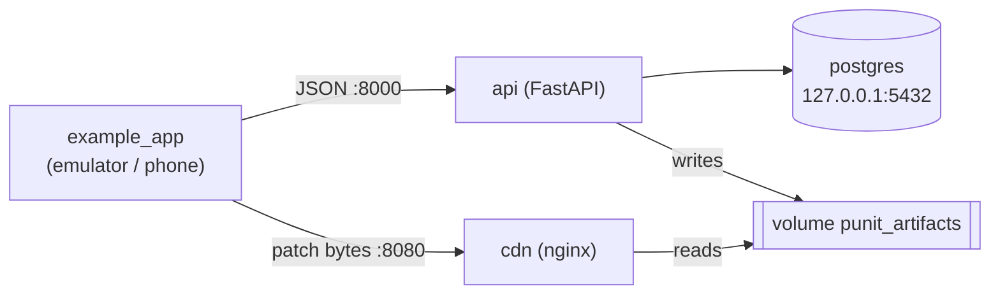

# Installation (local Docker stack)

This tutorial runs a complete Punit server on your own computer with Docker, publishes a test
patch, and shows it arriving in the example Flutter app. It takes about 15–30 minutes.

> [!NOTE]
> **What is tested.** The maintainers test this local stack on Linux (Ubuntu) with
> `scripts/verify_demo.sh`, also in CI. macOS and Windows hosts have not been tested. A
> production-style server setup exists but is **not yet verified end to end**
> ([operations.md](operations.md#single-server-deployment-draft)). Planned installation
> improvements: [roadmap/installation-improvements.md](roadmap/installation-improvements.md).

What you get:



## 1. Prerequisites

| Software | Version | Check |
|---|---|---|
| Git, Bash, curl | any recent | `git --version` |
| Docker Engine or Docker Desktop | 24 or newer, with **Compose v2** | `docker compose version` |
| Free ports | `8000` (API), `8080` (files), `5432` (Postgres) on 127.0.0.1 | change them in `.env` if taken |
| Python 3 | for the `ota` CLI (the server image and CI use 3.13) | `python3 --version` |
| Flutter (only for the app part) | stable ≥ 3.27, Dart ≥ 3.12 | `flutter --version` |
| Android emulator or phone (only for the app part) | — | `adb devices` |

On Ubuntu, Docker can be installed with:

```bash
sudo apt update
sudo apt install -y docker.io docker-compose-v2
sudo systemctl enable --now docker
sudo usermod -aG docker $USER
# log out and back in, then:
docker run --rm hello-world
```

## 2. Get the code and create `.env`

```bash
git clone https://github.com/punitsoni22/flutter_ota_system.git
cd flutter_ota_system
cp .env.example .env
```

`.env` holds **fake, local-only** values (passwords, keys and secrets that say "not-a-secret").
Never use them on a server. Every setting is explained in [configuration.md](configuration.md).

## 3. Start the stack

```bash
./scripts/setup_local.sh
```

This builds the API image, creates a **local development signing key** inside the Docker volume
`punit_keys` (it never touches your working tree), and starts `postgres`, `api` and `cdn`. It
ends with:

```
==> Ready.
  API:    http://localhost:8000   (OpenAPI docs: /docs)
  Admin:  http://localhost:8000/admin   (key: OTA_ADMIN_API_KEY in .env)
  CDN:    http://localhost:8080/health
```

Check it:

```bash
curl http://localhost:8000/health/ready    # {"status":"ok"}
curl http://localhost:8080/health          # ok
docker compose ps                          # postgres, api, cdn: all "(healthy)"
```

The database schema is created automatically: the API runs its migrations on every start.

## 4. Seed demo data and publish a test patch

```bash
./scripts/seed_demo.sh
```

This creates the application `punit-demo` (channels `dev`, `staging`, `production`) and the
release `android 1.0.0+1`. It prints the values the example app needs, including the public key:

```
application  punit-demo  (created)
channel      dev
release      android 1.0.0+1  (created)
signing key  local-dev-1 (LOCAL DEVELOPMENT KEY - not for production)

For example_app, pass:
  --dart-define=OTA_APP=punit-demo --dart-define=OTA_CHANNEL=dev \
  --dart-define=OTA_PUBLIC_KEY=local-dev-1:<base64 point>
```

Then publish a signed test patch (an inert JSON file, `mock-v1`) to 100% of `dev`:

```bash
./scripts/publish_test_patch.sh
```

## 5. Verify the whole pipeline

```bash
./scripts/verify_demo.sh
```

It registers a test device, checks for the patch, downloads it from the nginx file server,
verifies its SHA-256 and ES256 signature with an independent implementation, confirms that
corrupted files and tampered signatures are rejected, and exercises rollback and revoke. Every
line must say `[PASS]`, and the last line is:

```
RESULT: all checks passed (artifact pipeline; mock-v1 does not execute code)
```

## 6. Open the admin page and the API docs

- Admin page: <http://localhost:8000/admin>. Enter `OTA_ADMIN_API_KEY` from `.env`
  (`local-dev-admin-key-not-a-secret`) and click **Connect**. It shows apps, releases, patches,
  rollouts, boot success/failure counts and device counts. It is a static page served by the
  API; there is nothing extra to start.
- Interactive API docs (OpenAPI): <http://localhost:8000/docs>, and the raw spec at
  <http://localhost:8000/openapi.json>. They are disabled when `OTA_ENV=production`.

## 7. Install the `ota` CLI

From the repository root:

```bash
python3 -m venv .venv
.venv/bin/pip install -r cli/requirements.txt
alias ota="$PWD/.venv/bin/python $PWD/cli/ota.py"
export OTA_API_URL=http://localhost:8000
export OTA_API_KEY=local-dev-admin-key-not-a-secret   # = OTA_ADMIN_API_KEY in .env
ota app list
```

Expected: a JSON list that contains `punit-demo`. A wrong key prints
`error 401: Invalid or missing X-API-Key`. To keep the alias and variables, add those lines to
`~/.bashrc` or `~/.zshrc` with the full repository path instead of `$PWD`. All commands:
[cli-reference.md](cli-reference.md).

> ⚠️ If your shell already exports `OTA_API_URL` or `OTA_API_KEY` (for example for another
> server), every `ota` command uses those values. Check with `echo $OTA_API_URL` before you
> publish anything.

**Optional: install the CLI as a package (local build).** Instead of the alias, you can build a
wheel and install an `ota` command into its own virtual environment. The package is **not on
PyPI**; build it from this repository:

```bash
./scripts/build_cli.sh                     # writes cli/dist/punit_cli-0.1.0a0-py3-none-any.whl
python3 -m venv ~/.punit-cli
~/.punit-cli/bin/pip install cli/dist/punit_cli-0.1.0a0-py3-none-any.whl
~/.punit-cli/bin/ota --help                # or add ~/.punit-cli/bin to your PATH
```

Tested on Linux with Python 3.10 and 3.14. macOS and Windows are not tested.

## 8. Run the example app

The example app uses `mock-v1` patches: a patch is a JSON file that changes its banner and colour.
No code is downloaded.

**Let the device reach your computer.** Edit `.env`, then apply it with `docker compose up -d`:

| Device | `OTA_CDN_BASE_URL` in `.env` | `OTA_SERVER_URL` for the app | Also |
|---|---|---|---|
| Android emulator | `http://10.0.2.2:8080/cdn` | `http://10.0.2.2:8000` | — |
| Phone on the same Wi-Fi | `http://<your-computer-IP>:8080/cdn` | `http://<your-computer-IP>:8000` | `PUNIT_BIND_ADDRESS=0.0.0.0` |

Find your computer's IP with `hostname -I | awk '{print $1}'` (Linux) or
`ipconfig getifaddr en0` (macOS).

> [!WARNING]
> `PUNIT_BIND_ADDRESS=0.0.0.0` exposes the API and file server, with the fake keys, to your whole
> network. Use it only on a network you trust.

Start an emulator, then:

```bash
cd example_app
flutter run \
  --dart-define=OTA_SERVER_URL=http://10.0.2.2:8000 \
  --dart-define=OTA_APP=punit-demo \
  --dart-define=OTA_CHANNEL=dev \
  --dart-define=OTA_PUBLIC_KEY=local-dev-1:<base64 point printed by seed_demo.sh>
```

What you should see:

1. First start: **"Store build (no patch)"**, Active patch `none`. The app checks in the
   background and downloads the patch.
2. Tap **Check for update now**: "Patch 1 ready. Close and reopen the app."
3. Close the app fully (recent apps → swipe it away) and open it again: the banner and colour of
   patch 1, Active patch `#1`.

The example app allows plain `http://` (`android:usesCleartextTraffic="true"` in its manifest).
Your own production app should use HTTPS and must not keep that setting.

## 9. Try more cases (optional)

Make some patch files:

```bash
mkdir -p /tmp/ota && cd /tmp/ota
echo '{"banner":"Patch 2","color":"#2196F3"}' > p2.json
echo '{"banner":"Patch 3","color":"#9C27B0"}' > p3.json
echo '{"crash":true}'                         > crash.json
```

The emulator is `x86_64`; most phones are `arm64-v8a`. This helper uploads a file for both and
publishes it:

```bash
mkpatch() { ota patch create punit-demo --platform android --release 1.0.0+1 \
              --file x86_64="$1" --file arm64-v8a="$1" --channel "${2:-dev}" --percent "${3:-100}"; }
```

| Case | Do | Expected |
|---|---|---|
| Skip to the latest | `mkpatch p2.json`, `mkpatch p3.json`. In the app: Check, restart | Goes straight to the newest patch |
| Crash protection | `mkpatch crash.json`. Check, restart | The app closes at once (the demo's crash hook). Open it again: back on the previous patch. `ota patch show <id>` shows `patch_boot_failed: 1` |
| Crashed patch not retried | Tap Check | The app sends the crashed patch's id in `failed_patch_ids`, so the server skips it and offers the next best patch; it is never installed again on this device |
| Rollback | `ota patch list punit-demo --platform android --release 1.0.0+1`, then `ota patch rollback <id of newest>`. Check, restart | Back on the previous patch |
| Revoke | `ota patch revoke <id> --yes` | That patch never runs again |
| Server down | `docker compose stop api`, restart the app | App opens normally on its current code; Check says "Failed: …". Then `docker compose start api` |
| Rollout percentage | `mkpatch p2.json production 10`, then `.venv/bin/python scripts/simulate_fleet.py --app punit-demo --release 1.0.0+1 --channel production --devices 1000` | About 10% are offered the patch. Raise it with `ota patch rollout <id> --channel production --percent 50` and run again: about 50%, and the first 10% stay in |

`simulate_fleet.py` needs the `OTA_API_URL` variable from step 7 (default
`http://127.0.0.1:8000`).

Look inside the database at any time:

```bash
docker compose exec postgres psql -U punit -d punit -c "select number, status from patches order by created_at;"
docker compose exec postgres psql -U punit -d punit -c "select installation_id, release_version, channel, current_patch_number from devices;"
docker compose logs -f api
```

## 10. Stop, restart and clean up

```bash
docker compose stop              # stop, keep all data
./scripts/setup_local.sh         # start again (safe to re-run; never replaces .env or the key)
./scripts/cleanup_local.sh       # delete the database, patch files and the dev signing key (asks first)
```

After `cleanup_local.sh`, the next `setup_local.sh` creates a **new** signing key. Copy the new
`OTA_PUBLIC_KEY` from `seed_demo.sh` into the app, or every patch will be refused as signed by an
unknown key.

## Local development workflow

To work on Punit itself (run the tests, lint, change the code), see
[CONTRIBUTING.md](../CONTRIBUTING.md). The backend tests use SQLite and need no Docker.

## Next steps

- Connect your own app: [flutter-integration.md](flutter-integration.md)
- Ship releases and patches: [releases-and-patches.md](releases-and-patches.md)
- Something failed: [troubleshooting.md](troubleshooting.md)
