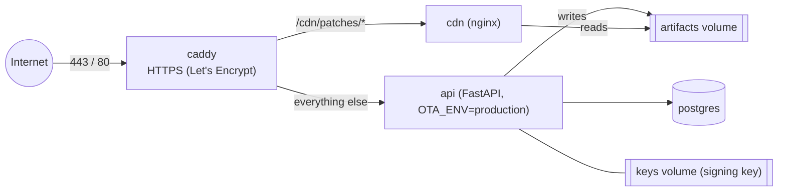

# Operations

Running a Punit server: deployment, monitoring, logs, backups and recovery. Read
[security.md](security.md) before exposing anything to the internet.

> [!WARNING]
> Punit is experimental and has not been validated in production. No load tests have been run, so
> there is no tested capacity figure. Validate it for your own apps before real users depend on
> it.

## Single-server deployment (draft)

> [!IMPORTANT]
> **Status: draft, not yet verified end to end.** Docker is Punit's official installation
> method, but this production-style setup has **not** been tested from a clean server for
> v0.1.0-alpha. Test it on a throwaway server first. Planned work:
> [roadmap/installation-improvements.md](roadmap/installation-improvements.md).

One Linux server runs everything with Docker Compose ([`deploy/`](../deploy/)):



Only Caddy publishes ports. `/cdn/*` paths other than `/cdn/patches/*` return 404, so store
builds are never public.

**Server size:** no measured requirement exists. The deploy files were written for a small VPS
(2 vCPU, 4 GB RAM, 40 GB disk, Ubuntu 24.04); treat that as a starting point, not a tested figure.

### 1. Prepare

```bash
# DNS: an A record ota.example.com -> the server's IP. Firewall: open 22, 80, 443 only.
curl -fsSL https://get.docker.com | sh
git clone https://github.com/punitsoni22/flutter_ota_system.git /opt/flutter_ota_system
cd /opt/flutter_ota_system/deploy
cp .env.example .env
for v in POSTGRES_PASSWORD OTA_ADMIN_API_KEY OTA_DEVICE_JWT_SECRET OTA_ROLLOUT_HMAC_SECRET; do
  sed -i "s|^$v=.*|$v=$(openssl rand -hex 32)|" .env
done
nano .env                      # set OTA_DOMAIN
```

### 2. Create the signing key (once, ever)

```bash
docker compose -f docker-compose.prod.yml build
docker compose -f docker-compose.prod.yml run --rm api python -m app.keygen
```

It writes the key into the `keys` volume and prints `OTA_PUBLIC_KEY for the apps: prod-1:…`.
**Back the key up offline.** Apps trust only this key; losing it means new store builds for every
app.

### 3. Start

```bash
docker compose -f docker-compose.prod.yml up -d
curl https://ota.example.com/health/ready      # {"status":"ok"}
```

The API refuses to start with unsafe settings and names them
([configuration.md](configuration.md#production-safety-checks)). Migrations run on every start.
The admin page is at `https://ota.example.com/admin`; `/docs` is off in production.

From your laptop or CI:

```bash
export OTA_API_URL=https://ota.example.com OTA_API_KEY=<OTA_ADMIN_API_KEY from deploy/.env>
ota app list
```

### What is public

| Path | Who can call it |
|---|---|
| `/v1/devices/*`, `/v1/updates/check`, `/v1/events/*` | Apps (registration is open; the rest needs a device token) |
| `/cdn/patches/*` | Anyone: signed diffs |
| `/v1/admin/*`, `/admin` | Admin API key (restrict at the network level too) |
| Store builds | Never public: admin API only |
| `/docs`, `/openapi.json` | Off in production |

### Other hosting

Any host that runs the API container with PostgreSQL and either a persistent disk + file server,
or S3-compatible buckets, can work; configure it with the variables in
[configuration.md](configuration.md). Only the Docker setups in this repository are documented
and supported: Punit is meant to be self-hosted.

## Monitoring

Punit has no metrics endpoint, dashboards or alerts. What exists:

| What | How |
|---|---|
| Process up | `GET /health/live` → `{"status":"ok"}` |
| Database reachable | `GET /health/ready` → `{"status":"ok"}`. Point an uptime monitor at it |
| Container health | `docker compose ps` (the API, nginx and Postgres containers have health checks) |
| Patch health | Per-patch counters: `ota patch show <id>` → `event_counts`, or the admin page |
| Adoption | `GET /v1/admin/apps/<slug>/devices/summary` or the admin page **Devices** table |

## Logs and telemetry

**Server logs** go to standard output (Uvicorn access logs plus the `ota` logger, which logs the
signing key id at startup):

```bash
docker compose logs -f api                                   # local
docker compose -f docker-compose.prod.yml logs -f api caddy  # single server
```

Logs are not structured (no JSON, no request ids) and there is no log shipping. Caddy's access
logs are your best record of admin actions, because there is no audit log.

**Device telemetry** is limited to seven event types per patch (`patch_downloaded`,
`patch_hash_failed`, `patch_signature_failed`, `patch_staged`, `patch_boot_succeeded`,
`patch_boot_failed`, `patch_auto_rollback`). The server keeps only **counts** per patch and type;
there is no per-device history. Events are best effort: the client keeps unsent events and retries
on the next call.

**Device logs** (Android, for debugging): `adb logcat | grep -E "OtaBoot|OTA:"`. `OtaBoot` logs
lines such as `Running patch <id>`, `Patch <id> did not confirm its last start: skipping it`, and
`OTA boot failed, running the store code`. Lines starting with `OTA:` come from the integration
helper in [flutter-integration.md](flutter-integration.md).

## Backup and restore

What must be backed up:

| Data | Where | Why |
|---|---|---|
| PostgreSQL | volume `pgdata` | Apps, releases, patches, signatures, rollouts, devices |
| Files | volume `artifacts` (`patches/` and `releases/`) | Patches and the store builds' code (needed to build new patches) |
| Signing key | volume `keys`, or your secret manager | Losing it means new store builds for every app |

### Single server

[`deploy/backup.sh`](../deploy/backup.sh) dumps the database and archives the files and key into
`deploy/backups/`, keeping 14 days:

```bash
crontab -e
0 3 * * * cd /opt/flutter_ota_system/deploy && ./backup.sh >> backups/backup.log 2>&1
```

Copy the backups off the server as well (for example with `rclone`), and protect them: they
contain the signing key.

Restore (**not yet tested**; practise it on a test server):

```bash
cd /opt/flutter_ota_system/deploy
docker compose -f docker-compose.prod.yml exec -T postgres pg_restore -U ota -d ota --clean < backups/db-<stamp>.dump
docker compose -f docker-compose.prod.yml exec -T api tar -C /data -xzf - < backups/files-<stamp>.tgz
docker compose -f docker-compose.prod.yml restart api
```

### Local stack

```bash
docker compose exec -T postgres pg_dump -U punit -d punit --format=custom > punit-db.dump
docker compose exec -T api tar -C /data -czf - artifacts keys > punit-files.tgz
```

## Failure recovery

| Failure | Effect on apps | Recovery |
|---|---|---|
| API down | Checks fail (`UpdateStatus.failed`); apps keep running their current code | Fix and restart; nothing is lost on the devices |
| Database down | `/health/ready` fails; checks fail | Restore the database; restart the API |
| File server down | Downloads fail; nothing is staged | Restart nginx; devices retry on their next check |
| Bad patch published | Devices that started it and crashed fall back on their own | `ota patch rollback` or `revoke` ([rollouts.md](rollouts.md)) |
| Lost artifacts volume | Published patches can't be downloaded; new patches can't be diffed against lost store builds | Restore from backup. Without the release's `libapp.so`, that release can't get new code patches |
| Lost signing key | No new patches can be trusted by existing apps | Restore from backup; otherwise new store builds with a new key |
| Leaked admin key or signing key | — | [security.md](security.md#compromised-signing-key-procedure) and rotate ([secret rotation](security.md#secret-rotation)) |

## Upgrading Punit

```bash
cd /opt/flutter_ota_system && git pull
cd deploy && docker compose -f docker-compose.prod.yml up -d --build
```

Database migrations run automatically on start. Before v1.0 the API, schema and patch formats may
change between versions; read the [CHANGELOG](../CHANGELOG.md) and back up first. Upgrades have
not been tested across versions yet.

## Production considerations

- [ ] Random 32+ character secrets; `OTA_ENV=production` (the API checks this)
- [ ] HTTPS for the API and file server; no `usesCleartextTraffic` in apps
- [ ] Signing key created once, backed up offline, readable only by the API
- [ ] Apps ship with the production key **and** a backup key ([security.md](security.md#trusted-keys-in-apps-and-rotation))
- [ ] Admin access restricted at the network level; admin key shared with as few people as possible
- [ ] Off-server backups, and a tested restore
- [ ] Uptime monitoring on `/health/ready`
- [ ] A written rollout procedure (staging → 1% → … → 100%) and who may run it
- [ ] Store-policy decision recorded for each `public_store` app
- [ ] Your own load test if you expect many devices: Punit publishes no capacity figures
