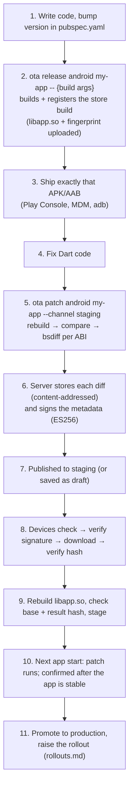

# Releases and patches

How to ship a store build ("full release") and then send OTA patches to it. Prerequisites: a
running server, the `ota` CLI ([installation.md](installation.md#7-install-the-ota-cli)) and an
app connected with `ota_client` ([flutter-integration.md](flutter-integration.md)). Terms:
[concepts.md](concepts.md).

## Full release vs patch

| | Full release (store build) | OTA patch |
|---|---|---|
| What it is | A complete APK/AAB you ship through a store or install | A change for **one** release, delivered by Flutter OTA System |
| Can change | Anything: Dart, native code, plugins, assets, permissions, Flutter version | **Android code patches:** Dart code only. **`mock-v1`:** only the data your app reads |
| Reaches users | Through the store's review and update | On the next app start after a check |
| Identified by | platform + full version, e.g. `android 1.0.0+1` | release + number: patch 1, 2, 3… |
| Created with | `ota release android` (code patches) or `ota release create` | `ota patch android` (code) or `ota patch create` (`mock-v1`) |

## The complete workflow



Steps 6–10 happen automatically. You run steps 2, 3, 5 and 11.

## Android code patches

> 🟡 **Experimental.** Android release builds only. See the requirements in
> [flutter-integration.md](flutter-integration.md).

### Register the app (once)

```bash
ota app create my-app "My App" --distribution public_store    # or enterprise (default)
ota app approve-policy my-app --reason "Dart-only code patches; reviewed by <name>"   # public_store only
```

### 1. Build and register a store release

Run this in your Flutter project, from clean, committed code. Everything after `--` is passed to
`flutter build` unchanged, so include the OTA settings and your app's own flags:

```bash
cd ~/path/to/my_app
git status                                   # nothing uncommitted
ota release android my-app -- \
  --dart-define=OTA_SERVER_URL=https://ota.example.com \
  --dart-define=OTA_PUBLIC_KEY=prod-1:BIi7De… \
  --dart-define=API_BASE_URL=https://api.example.com
```

What it does ([`cli/android.py`](../cli/android.py)):

1. Reads the version from `pubspec.yaml` (`--build-name` / `--build-number` override it).
2. Runs `flutter build appbundle --release` (or `apk` with `--kind apk`). It adds
   `--no-tree-shake-icons` so a later patch may use any Material icon; `--tree-shake-icons`
   turns that off.
3. Extracts `lib/<abi>/libapp.so` for each ABI and fingerprints everything else: native
   libraries, `.dex` code, the manifest, resources and Flutter assets. It also saves the Flutter
   version and the build arguments.
4. Registers the release and uploads each `libapp.so` as a **private** release artifact.

It ends with:

```
Release 1.0.0+1 registered for 'my-app' (arm64-v8a, armeabi-v7a, x86_64).
Ship exactly this file (store upload or install): .../app-release.aab
Patches are diffed against its code, so a rebuilt file needs a new release.
```

Then:

- **Ship exactly that file.** A rebuilt file is a different build, and patches will not apply to
  it.
- Tag the code, so you can patch this release later: `git tag v1.0.0+1`.
- One version = one build. A tester APK and a Play AAB of the same version are two builds: give
  the tester build its own build number (e.g. `1.0.0+1001`).
- Already built? `--artifact path/to/app.aab` registers an existing file (pass the same build
  arguments after `--`).

### Install builds for testing

| Where | How |
|---|---|
| Emulator / phone on USB | `adb install -r build/app/outputs/flutter-apk/app-release.apk` (register with `--kind apk`) |
| Testers elsewhere | Send them the registered APK; they allow "install unknown apps" |
| Play build | Play Console → Internal testing → upload the registered AAB |

Open the app once: it registers and appears in the admin page's **Devices** table after its first
check. Do not `flutter run` or reinstall a rebuilt APK between patches: a rebuilt APK is a
different build, and patches will not apply to it.

### 2. Create and publish a code patch

Change Dart code, then in the project folder:

```bash
ota patch android my-app --channel staging --note "fix checkout total"
```

What it does:

1. Finds the release matching `pubspec.yaml`'s version (or `--release 1.0.0+1`).
2. Refuses if your Flutter version differs from the release's: `error: Flutter changed (…)`.
3. Rebuilds with the release's saved build arguments.
4. Compares the new build with the release's fingerprint and refuses any change outside Dart
   (see below).
5. Downloads the release's `libapp.so` for each ABI, computes an `OTADIF01` binary diff, and
   checks that the diff rebuilds the new file exactly.
6. Creates the patch and uploads one diff per ABI with the hash of the rebuilt file. The
   **server signs** each artifact when it receives it.
7. Publishes it to `--channel` at `--percent` (default 100). Without `--channel` it stays a
   **draft**.

Output:

```
  arm64-v8a: libapp.so 13.8 MB → patch 42 KB (5s)
  ...
Patch #1 for 1.0.0+1: published to staging at 100%. id bcd8ebac-…
```

Patch sizes depend on how much compiled code changes. No size benchmarks are published.

### What a code patch can change

| Can change | Needs a new store release |
|---|---|
| Dart code in your app | Flutter version |
| Pure-Dart packages | Plugins with native code, native libraries (`.so`) |
| | Java/Kotlin code (`.dex`) |
| | `AndroidManifest.xml`, resources |
| | Flutter assets: images, fonts, `.env` files, and the icon font if icons are tree-shaken |

The CLI enforces this and lists what changed. `--allow-native-diffs` and `--allow-asset-diffs`
exist but are dangerous: the patch still contains only Dart code, so the app would run new Dart
code against old native code or assets.

### See it on a device

1. Close the app fully (recent apps → swipe it away), open it, and wait about 10 seconds. It
   downloads the patch; the screen does not change yet.
2. Close it fully again and open it. The new code runs. A few seconds later the admin page shows
   **Boot ok** for the patch.

**Testing crash protection:** put a crash in startup code, for example
`WidgetsBinding.instance.addPostFrameCallback((_) => exit(1));` (with `import 'dart:io';`), send
it as a patch to `staging`, and restart twice. The app closes at once; open it again and it runs
the previous good code. The admin page shows the patch as **Crashing**. Remove the crash line
afterwards.

### 3. Roll it out

Testers on `staging` get it on their next check and run it after a restart. Then promote it and
raise the percentage step by step: [rollouts.md](rollouts.md).

### Ship one fix while `main` has other work

A patch is always **the whole app as your code is now**. If `main` has unfinished work, build the
patch from the release's tag:

```bash
git switch -c hotfix/1.0.0+1 v1.0.0+1      # code exactly as shipped
git cherry-pick <commit with the fix>
ota patch android my-app --channel staging --note "checkout fix"
git switch main
```

The next patch for that release must be built from that branch again (patch 2 = tag + fix 1 +
fix 2).

## Config patches (`mock-v1`)

For `mock-v1` you create the release and the patch files yourself. The server signs whatever file
you upload.

```bash
ota release create my-app --platform android --version 1.0.0+1
echo '{"banner":"Hello from patch 1","color":"#4CAF50"}' > p1.json
ota patch create my-app --platform android --release 1.0.0+1 \
  --file arm64-v8a=p1.json --file x86_64=p1.json \
  --channel dev --percent 100
```

`--file ARCH=PATH` can be repeated; a device is offered the patch only if there is a file for its
architecture. Without `--channel`, the patch stays a draft; publish it later with
`ota patch publish <id> --channel dev --percent 100`. The admin page can also create `mock-v1`
patches (paste JSON or pick a file).

## Several releases, each with its own patches

Patches belong to exactly one release, so you can maintain several store versions at once:

```bash
# Version 1.0.0+1 is in the store; 1.1.0+2 has just been released.
ota patch list my-app --platform android --release 1.0.0+1
ota patch list my-app --platform android --release 1.1.0+2

# A fix for both: build each from its own release tag.
git switch -c hotfix/1.0.0+1 v1.0.0+1 && git cherry-pick <fix>
ota patch android my-app --release 1.0.0+1 --channel staging     # becomes patch #3 of 1.0.0+1
git switch -c hotfix/1.1.0+2 v1.1.0+2 && git cherry-pick <fix>
ota patch android my-app --release 1.1.0+2 --channel staging     # becomes patch #1 of 1.1.0+2
```

| Device | Gets |
|---|---|
| On `1.0.0+1` | Patch 3 of `1.0.0+1` (the newest it is eligible for) |
| On `1.1.0+2` | Patch 1 of `1.1.0+2` |
| Updated from the store `1.0.0+1` → `1.1.0+2` | Its `1.0.0+1` patches are deleted; it starts fresh on `1.1.0+2` |

## The next store release

1. Bump `version:` in `pubspec.yaml` (e.g. `1.1.0+2`).
2. `ota release android my-app -- <flags>` and tag it.
3. Upload it to the store.

Devices still on the old version keep getting the old version's patches.

## Inspect and clean up

```bash
ota release list my-app                                        # releases, artifacts, fingerprints
ota patch list my-app --platform android --release 1.0.0+1     # one line per patch: number, status, format, rollout, id
ota patch show <patch_id>                                       # one patch as JSON, incl. event_counts
ota release delete my-app --version 1.0.0+1001                  # remove a test release
```

`release delete` is refused while any of its patches is `published`: roll back or revoke them
first. Stored files are kept, because they are content-addressed and may be shared.

All commands and options: [cli-reference.md](cli-reference.md). Problems:
[troubleshooting.md](troubleshooting.md).
