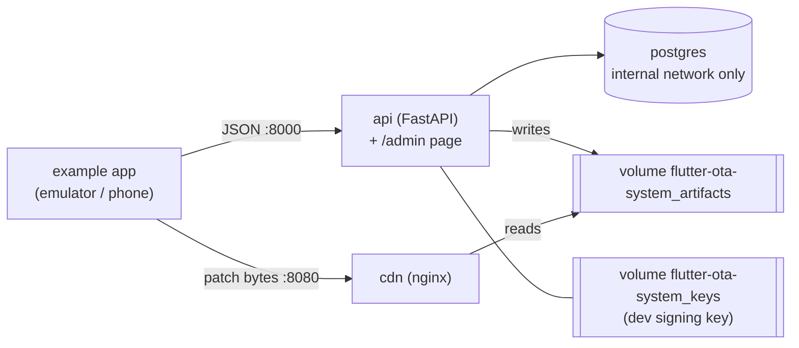

# Self-hosting

Run your own Flutter OTA System server. This page starts the **local Docker stack** (development
and evaluation). For a single-server production-style setup, see
[operations](operations.md#single-server-deployment-draft).

It runs the API (FastAPI), PostgreSQL and a file server for patches with **one command**
(`./flutter-ota-system.sh setup`), in about 5 minutes.

> [!NOTE]
> **What is tested.** Linux (Ubuntu) is the primary verified environment: the maintainers
> test this local stack there with `./flutter-ota-system.sh` and `scripts/verify_demo.sh`, also in CI. Android
> is the only internally tested app platform. Installation on macOS or Windows (including
> Docker Desktop) has not been verified; see [compatibility](limitations.md#compatibility) and
> [platform notes](#platform-notes-macos-and-windows-not-tested) below. A production-style server
> setup exists but is **not yet verified end to end**
> ([operations.md](operations.md#single-server-deployment-draft)). Planned installation
> improvements: [roadmap](roadmap/README.md#planned--not-implemented).

> [!WARNING]
> This stack is for **local development and evaluation only**. Its signing key is a local
> development key, and Flutter OTA System is not production-ready
> ([limitations](limitations.md)).

What you get:



| Container | Image | Host port | Purpose |
|---|---|---|---|
| `api` | built locally from `backend/` (`flutter-ota-system-api:local`) | `127.0.0.1:8000` | Control plane, admin API, `/admin` page, `/docs` |
| `cdn` | `nginx:1.27.5-alpine` | `127.0.0.1:8080` | Serves the immutable, content-addressed patch files |
| `postgres` | `postgres:17.11-alpine` | none (opt-in, [see below](#postgres-from-your-computer-optional)) | Database |

There is no Redis and no background worker: the backend does not use them. Database migrations run
automatically when the API starts.

## 1. Prerequisites

| Software | Needed for | Version | Check |
|---|---|---|---|
| Git, Bash, curl | everything | any recent | `git --version`, `curl --version` |
| Docker Engine (tested on Linux) or Docker Desktop (not tested) | the server | 24 or newer, with **Compose v2.20+** | `docker compose version` |
| Free ports `8000` and `8080` on 127.0.0.1 | the server | — | change them in `.env` if taken ([below](#ports-are-taken-or-a-second-stack)) |
| Python 3.10+ with `venv` | the `ota` CLI only | 3.10 or newer | `python3 --version` |
| Flutter OTA toolchain | connecting an app (not the server) | Flutter 3.47.9 or 3.50.0 with the custom engine, installed by `flutter_ota` ([quick start](quick-start.md)) | `flutter_ota toolchain doctor` |
| Android emulator or phone + `adb` | the example app only (Android is the only tested app platform) | — | `adb devices` |

Only Docker is needed to run the server. Nothing else is installed on your computer: the server
runs in containers.

On Ubuntu, Docker can be installed with:

```bash
sudo apt update
sudo apt install -y docker.io docker-compose-v2
sudo systemctl enable --now docker
sudo usermod -aG docker $USER
# log out and back in, then:
docker run --rm hello-world
```

For the CLI on Ubuntu you may also need `sudo apt install -y python3-venv`.

## 2. Get the code and run setup

```bash
git clone https://github.com/punitsoni22/flutter_ota_system.git
cd flutter_ota_system
./flutter-ota-system.sh setup
```

`setup` does everything in order, and stops with a clear `ERROR` message if a step fails:

1. Checks Docker, Compose v2 and the required files; checks that ports 8000 and 8080 are free.
2. Creates `.env` from [`.env.example`](../.env.example) **if it does not exist**, with random
   local values for the database password, admin key and the two server secrets (file mode 600).
3. Builds the API image locally (the first build takes a few minutes).
4. Creates the **local development signing key** once, inside the Docker volume `flutter-ota-system_keys`
   (mode 600, owned by the API's non-root user). It never touches your working tree.
5. Starts `postgres`, `api` and `cdn` and waits until all three are healthy.
6. Checks the API, the admin page and the file server from your computer, then prints the URLs.

The end of the output looks like this:

```
==> Checking from the host
 OK API ready      http://localhost:8000/health/ready
 OK Admin page     http://localhost:8000/admin
 OK File server    http://localhost:8080/health

  API:        http://localhost:8000            (OpenAPI docs: http://localhost:8000/docs)
  Admin page: http://localhost:8000/admin      (key: OTA_ADMIN_API_KEY in .env)
  Files:      http://localhost:8080/cdn/patches/<sha256>
  Project:    flutter-ota-system   (volumes flutter-ota-system_pgdata, _artifacts, _keys)
  App key:    OTA_PUBLIC_KEY=local-dev-1:<base64 point>
              (LOCAL DEVELOPMENT KEY - never use it for production apps)

Next steps
  ./flutter-ota-system.sh demo      seed flutter-ota-system-demo, publish a signed test patch, verify everything
  ...
```

**Safe to re-run.** `setup` never overwrites an existing `.env`, never replaces the signing key and
never deletes data. Run it again whenever you are unsure; it just checks and starts the stack.

Settings are explained in [configuration.md](configuration.md#local-stack-settings-env-docker-compose).

## 3. Check the stack

```bash
./flutter-ota-system.sh status
```

It lists the containers (all `(healthy)`), checks the URLs and prints the app's `OTA_PUBLIC_KEY`.
By hand:

```bash
curl http://localhost:8000/health/ready    # {"status":"ok"}
curl http://localhost:8080/health          # ok
```

## 4. Verify the server: seed, publish a test patch, check

```bash
./flutter-ota-system.sh demo
```

This runs three steps (also available as separate scripts):

| Step | Script | What it does |
|---|---|---|
| Seed | `scripts/seed_demo.sh` | Creates the application `flutter-ota-system-demo` (channels `dev`, `staging`, `production`) and the release `android 1.0.0+1`. Safe to re-run |
| Publish | `scripts/publish_test_patch.sh [--banner TEXT] [--color '#RRGGBB']` | Publishes a signed test patch (an inert JSON file, `mock-v1`) to 100% of `dev` |
| Verify | `scripts/verify_demo.sh` (= `./flutter-ota-system.sh verify`) | Registers a test device, checks for the patch, downloads it from the nginx file server, verifies its size, SHA-256 and ES256 signature with an independent implementation, confirms that corrupted files and tampered signatures are rejected, and exercises rollback and revoke |

Expected output (shortened):

```
application  flutter-ota-system-demo  (created)
channel      dev
release      android 1.0.0+1  (created)
signing key  local-dev-1 (LOCAL DEVELOPMENT KEY - not for production)

For the example app (packages/ota_client/example), pass:
  --dart-define=OTA_APP=flutter-ota-system-demo --dart-define=OTA_CHANNEL=dev \
  --dart-define=OTA_APPLICATION_ID=<the demo app's server id> \
  --dart-define=OTA_PUBLIC_KEY=local-dev-1:<base64 point>
published patch #1  id=…
[PASS] API reachable from host
…
[PASS] SHA-256 verification  (…)
[PASS] ES256 signature verification
…
RESULT: all checks passed (artifact pipeline; mock-v1 does not execute code)
```

Every line must say `[PASS]`. `./flutter-ota-system.sh verify` exits non-zero if any check fails.

## 5. Open the admin page and the API docs

- Admin page: <http://localhost:8000/admin>. Paste `OTA_ADMIN_API_KEY` from `.env`
  (`grep OTA_ADMIN_API_KEY .env`) and click **Connect**. It shows apps, releases, patches,
  rollouts per channel, boot success/failure counts and device counts. It is a static page served
  by the API; there is nothing extra to start.
- Interactive API docs (OpenAPI): <http://localhost:8000/docs>, and the raw spec at
  <http://localhost:8000/openapi.json>. They are disabled when `OTA_ENV=production`.

## 6. Day-to-day commands

| Command | What it does | Data and key |
|---|---|---|
| `./flutter-ota-system.sh up` (or `start`) | Start the stack and wait until healthy | kept |
| `./flutter-ota-system.sh stop` | Stop the containers | kept |
| `./flutter-ota-system.sh down` | Remove the containers and network | kept (volumes stay) |
| `./flutter-ota-system.sh restart` | Restart all services and wait until healthy | kept |
| `./flutter-ota-system.sh status` | Containers, health, URLs, volumes, `OTA_PUBLIC_KEY` | — |
| `./flutter-ota-system.sh logs [api\|cdn\|postgres]` | Follow the logs (Ctrl+C to leave) | — |
| `./flutter-ota-system.sh psql [-c "SQL"]` | psql inside the database container | — |
| `./flutter-ota-system.sh update` | Back up, rebuild the API image from your checkout, recreate, wait. Run `git pull` first yourself | kept; migrations run on start |
| `./flutter-ota-system.sh backup [dir]` | Database dump + patch files + signing key + a copy of `.env` into `backups/<project>-<time>/` | — |
| `./flutter-ota-system.sh restore <dir>` | Replace database, files and key with a backup. Asks you to type `restore` | **replaced** |
| `./flutter-ota-system.sh reset` | **Delete** database, files and signing key. Asks you to type the project name (`flutter-ota-system`) | **deleted** (`.env` and `backups/` stay) |
| `./flutter-ota-system.sh help` | All commands | — |

Plain `docker compose …` commands also work from the repository folder (Compose reads `.env`).

Look inside the database:

```bash
./flutter-ota-system.sh psql -c "select number, status from patches order by created_at;"
./flutter-ota-system.sh psql -c "select installation_id, release_version, channel, current_patch_number from devices;"
```

More (backups, recovery, upgrades): [operations.md](operations.md#local-stack).

## 7. Install the `ota` CLI

```bash
./flutter-ota-system.sh cli               # builds the wheel (scripts/build_cli.sh) and installs it into .venv-cli/
./flutter-ota-system.sh ota app list      # runs the CLI against THIS stack
```

Expected: a JSON list that contains `flutter-ota-system-demo`. `./flutter-ota-system.sh ota …` takes the server address
and the admin key from `.env` and **ignores** any `OTA_API_URL` / `OTA_API_KEY` already exported
in your shell, so it can never talk to another server by mistake. The package is built locally
and is **not on PyPI**. It needs Python 3.10+ (tested on Linux with Python 3.10 and 3.14).

To use the CLI directly (for example against another server), set the variables yourself:

```bash
export OTA_API_URL=http://localhost:8000
export OTA_API_KEY=<OTA_ADMIN_API_KEY from .env>
.venv-cli/bin/ota app list            # or add .venv-cli/bin to your PATH
```

> ⚠️ If your shell already exports `OTA_API_URL` or `OTA_API_KEY` (for example for another
> server), every direct `ota` command uses those values. Check with `echo $OTA_API_URL` before
> you publish anything.

Without the package: `python3 -m venv .venv && .venv/bin/pip install -r cli/requirements.txt`,
then run `.venv/bin/python cli/ota.py …`. All commands: [cli-reference.md](cli-reference.md).

## 8. Connect an app

The server is now ready for apps:

- **Bytecode architecture** (`flutter_ota`): follow the [quick start](quick-start.md) from step 3
  (`flutter_ota init`, `config set server-url http://127.0.0.1:8000`, `keys init`, `release
  android`, `patch android`). With a phone on USB, run `adb reverse tcp:8000 tcp:8000` and
  `adb reverse tcp:8080 tcp:8080` so the phone reaches this computer; release builds accept plain
  `http://` only to loopback addresses. The [demo app](../packages/ota_client/example/README.md)
  shows the whole flow.
- **Original alpha** (`ota`, `mock-v1` / `aot-bidiff`): `./flutter-ota-system.sh demo` seeds a
  demo app and publishes a signed `mock-v1` test patch; see
  [releases and patches](releases-and-patches.md#original-alpha-patch-formats).

## Platform notes (macOS and Windows: not tested)

The maintainers run and test Flutter OTA System on **Linux** only. The notes below are what we expect, not
what we verified:

- **macOS (not tested):** Docker Desktop provides Docker and Compose v2. `flutter-ota-system.sh` uses Bash and
  standard tools (`od`, `sed`, `shasum` as a fallback for `sha256sum`) and tries to avoid
  GNU-only flags and Bash 4-only features (macOS ships Bash 3.2). None of this has been run on a
  Mac.
- **Windows (not tested):** use **WSL2** with Docker Desktop's WSL integration (or Docker Engine
  inside WSL2), and run every command inside the WSL2 Linux shell, from a clone inside the WSL2
  file system (not `/mnt/c/...`). Plain PowerShell/cmd is not supported by the scripts.
- `COMPOSE_FILE` in `.env` uses `:` between files; Windows-native Compose would need `;`.

If you try another platform, please report what worked and what did not
([CONTRIBUTING.md](../CONTRIBUTING.md)).

## Ports are taken, or a second stack

`setup` stops with `Port 8000 (FLUTTER_OTA_API_PORT) is already in use` when something else uses a
port. Pick other ports **before the first setup** by exporting them; they are written into the
new `.env`:

```bash
FLUTTER_OTA_API_PORT=18000 FLUTTER_OTA_CDN_PORT=18080 ./flutter-ota-system.sh setup
```

(`OTA_CDN_BASE_URL` follows `FLUTTER_OTA_CDN_PORT` automatically.) For an existing `.env`, edit
`FLUTTER_OTA_API_PORT`, `FLUTTER_OTA_CDN_PORT` **and** the port in `OTA_CDN_BASE_URL`, then `./flutter-ota-system.sh up`.

To run a **second, independent stack** next to the first one (for example a second checkout),
also give it its own Compose project name and image tag:

```bash
COMPOSE_PROJECT_NAME=flutter-ota-system-test FLUTTER_OTA_API_IMAGE=flutter-ota-system-test-api:local \
FLUTTER_OTA_API_PORT=18000 FLUTTER_OTA_CDN_PORT=18080 ./flutter-ota-system.sh setup
```

Its containers, volumes (`flutter-ota-system-test_pgdata`, …) and key are separate. Every `./flutter-ota-system.sh` command
in that checkout then acts on `flutter-ota-system-test` only.

## Postgres from your computer (optional)

The database is on an internal Docker network and has no host port. `./flutter-ota-system.sh psql` and
`docker compose exec postgres psql -U flutter_ota -d flutter_ota` work without one. To connect another tool
(DBeaver, a local `psql`), add this line to `.env` and run `./flutter-ota-system.sh up`:

```bash
COMPOSE_FILE=docker-compose.yml:docker/compose.postgres-port.yml
```

Postgres is then reachable on `127.0.0.1:${FLUTTER_OTA_POSTGRES_PORT}` (default 5432), with
`POSTGRES_USER` / `POSTGRES_PASSWORD` from `.env`. Remove the line and run `./flutter-ota-system.sh up` to
close it again.

## Stop, clean up, start fresh

```bash
./flutter-ota-system.sh stop      # stop; everything is kept
./flutter-ota-system.sh down      # remove containers; database, files and key are kept in volumes
./flutter-ota-system.sh up        # start again (same data, same key)
./flutter-ota-system.sh reset     # DELETE database, patch files and the dev signing key (asks first)
```

After `reset`, the next `./flutter-ota-system.sh setup` creates a **new** signing key. Rebuild the app with the
new `OTA_PUBLIC_KEY` from `./flutter-ota-system.sh status`, or every patch will be refused as signed by an
unknown key. Take a `./flutter-ota-system.sh backup` first if you may want the data back.

The older scripts still work and do the same things: `scripts/setup_local.sh` (= `setup`),
`scripts/seed_demo.sh`, `scripts/publish_test_patch.sh`, `scripts/verify_demo.sh`, and
`scripts/cleanup_local.sh [--yes|--keep-data]` (non-interactive reset for CI).

## Local development workflow

To work on Flutter OTA System itself (run the tests, lint, change the code), see
[CONTRIBUTING.md](../CONTRIBUTING.md). The backend tests use SQLite and need no Docker.

## Next steps

- Connect your own app: [quick start](quick-start.md)
- Run a production-style server: [operations](operations.md)
- Ship releases and patches: [releases and patches](releases-and-patches.md)
- Something failed: [troubleshooting.md](troubleshooting.md)
